<!-- GENERATED by tools/validate_catalogue.py --write-docs; do not edit. -->

# Hand-off pipeline

Which skill's work product feeds which, generated from `metadata.outputs-to` and `metadata.inputs-from` in each `SKILL.md`. Skills are grouped by stage.

```mermaid
flowchart LR
  subgraph stage_foundations["Foundations"]
    glossary["glossary"]
    re_setup(["re-setup"])
    requirement_classifier["requirement-classifier"]
  end
  subgraph stage_scope["Scope and context"]
    source_inventory["source-inventory"]
    stakeholder_map(["stakeholder-map"])
    system_context(["system-context"])
  end
  subgraph stage_elicitation["Elicitation"]
    artifact_mining["artifact-mining"]
    clarifying_questions["clarifying-questions"]
    elicitation_workshop(["elicitation-workshop"])
    interview_guide(["interview-guide"])
    observation_protocol(["observation-protocol"])
    questionnaire_builder(["questionnaire-builder"])
  end
  subgraph stage_specification["Specification"]
    constraints_register["constraints-register"]
    domain_model["domain-model"]
    process_flow["process-flow"]
    quality_requirements(["quality-requirements"])
    requirement_phrasing["requirement-phrasing"]
    spec_assembler(["spec-assembler"])
    state_model["state-model"]
    use_case_spec(["use-case-spec"])
    user_story_refiner(["user-story-refiner"])
  end
  subgraph stage_negotiation["Negotiation"]
    conflict_detector["conflict-detector"]
    conflict_to_decision(["conflict-to-decision"])
  end
  subgraph stage_validation["Validation"]
    prototype_brief(["prototype-brief"])
    requirement_linter["requirement-linter"]
    requirements_review(["requirements-review"])
    testability_check["testability-check"]
  end
  subgraph stage_management["Management"]
    attribute_schema["attribute-schema"]
    baseline(["baseline"])
    change_impact(["change-impact"])
    prioritization(["prioritization"])
    traceability_matrix["traceability-matrix"]
  end
  subgraph stage_integration["Integration"]
    issue_sync(["issue-sync"])
    reqif_bridge(["reqif-bridge"])
    to_openspec(["to-openspec"])
  end
  subgraph stage_primitives["Primitives"]
    re_ids["re-ids"]
    re_interview["re-interview"]
    re_templates["re-templates"]
  end
  artifact_mining --> clarifying_questions
  artifact_mining --> constraints_register
  artifact_mining --> domain_model
  artifact_mining --> elicitation_workshop
  artifact_mining --> glossary
  artifact_mining --> interview_guide
  artifact_mining --> process_flow
  artifact_mining --> quality_requirements
  artifact_mining --> questionnaire_builder
  artifact_mining --> requirement_classifier
  artifact_mining --> requirement_phrasing
  artifact_mining --> source_inventory
  artifact_mining --> state_model
  artifact_mining --> system_context
  artifact_mining --> use_case_spec
  artifact_mining --> user_story_refiner
  attribute_schema --> baseline
  attribute_schema --> issue_sync
  attribute_schema --> re_ids
  attribute_schema --> reqif_bridge
  attribute_schema --> requirement_linter
  attribute_schema --> spec_assembler
  baseline --> change_impact
  baseline --> reqif_bridge
  baseline --> spec_assembler
  baseline --> traceability_matrix
  change_impact --> baseline
  change_impact --> conflict_detector
  change_impact --> issue_sync
  change_impact --> prioritization
  change_impact --> requirement_linter
  change_impact --> requirement_phrasing
  change_impact --> traceability_matrix
  clarifying_questions --> constraints_register
  clarifying_questions --> process_flow
  clarifying_questions --> quality_requirements
  clarifying_questions --> requirement_classifier
  clarifying_questions --> requirement_linter
  clarifying_questions --> requirement_phrasing
  clarifying_questions --> state_model
  clarifying_questions --> system_context
  clarifying_questions --> testability_check
  clarifying_questions --> use_case_spec
  clarifying_questions --> user_story_refiner
  conflict_detector --> conflict_to_decision
  conflict_detector --> glossary
  conflict_detector --> requirements_review
  conflict_to_decision --> baseline
  conflict_to_decision --> change_impact
  conflict_to_decision --> requirement_linter
  conflict_to_decision --> requirement_phrasing
  conflict_to_decision --> requirements_review
  conflict_to_decision --> traceability_matrix
  constraints_register --> change_impact
  constraints_register --> conflict_detector
  constraints_register --> requirement_linter
  constraints_register --> requirements_review
  constraints_register --> spec_assembler
  constraints_register --> testability_check
  constraints_register --> to_openspec
  constraints_register --> traceability_matrix
  domain_model --> glossary
  domain_model --> requirement_phrasing
  domain_model --> requirements_review
  domain_model --> spec_assembler
  domain_model --> state_model
  elicitation_workshop --> conflict_detector
  elicitation_workshop --> glossary
  elicitation_workshop --> prioritization
  elicitation_workshop --> requirement_classifier
  elicitation_workshop --> requirement_phrasing
  elicitation_workshop --> user_story_refiner
  glossary --> artifact_mining
  glossary --> clarifying_questions
  glossary --> domain_model
  glossary --> elicitation_workshop
  glossary --> interview_guide
  glossary --> observation_protocol
  glossary --> quality_requirements
  glossary --> requirement_phrasing
  glossary --> requirements_review
  glossary --> spec_assembler
  glossary --> stakeholder_map
  glossary --> state_model
  glossary --> system_context
  glossary --> use_case_spec
  glossary --> user_story_refiner
  interview_guide --> conflict_detector
  interview_guide --> constraints_register
  interview_guide --> elicitation_workshop
  interview_guide --> glossary
  interview_guide --> observation_protocol
  interview_guide --> quality_requirements
  interview_guide --> questionnaire_builder
  interview_guide --> requirement_classifier
  interview_guide --> requirement_phrasing
  interview_guide --> source_inventory
  issue_sync --> baseline
  issue_sync --> change_impact
  issue_sync --> traceability_matrix
  observation_protocol --> glossary
  observation_protocol --> prioritization
  observation_protocol --> process_flow
  observation_protocol --> questionnaire_builder
  observation_protocol --> requirement_classifier
  observation_protocol --> requirement_phrasing
  prioritization --> baseline
  prioritization --> conflict_detector
  prioritization --> conflict_to_decision
  prioritization --> issue_sync
  prioritization --> spec_assembler
  process_flow --> requirement_phrasing
  process_flow --> requirements_review
  process_flow --> spec_assembler
  process_flow --> state_model
  process_flow --> testability_check
  prototype_brief --> conflict_detector
  prototype_brief --> requirement_phrasing
  prototype_brief --> requirements_review
  prototype_brief --> testability_check
  quality_requirements --> conflict_detector
  quality_requirements --> constraints_register
  quality_requirements --> requirement_linter
  quality_requirements --> requirements_review
  quality_requirements --> spec_assembler
  quality_requirements --> testability_check
  quality_requirements --> to_openspec
  questionnaire_builder --> artifact_mining
  questionnaire_builder --> prioritization
  questionnaire_builder --> requirement_classifier
  questionnaire_builder --> requirement_phrasing
  re_ids --> requirement_linter
  re_ids --> source_inventory
  re_ids --> traceability_matrix
  re_interview --> clarifying_questions
  re_interview --> conflict_detector
  re_interview --> conflict_to_decision
  re_interview --> glossary
  re_interview --> interview_guide
  re_interview --> stakeholder_map
  re_interview --> system_context
  re_setup --> attribute_schema
  re_setup --> change_impact
  re_setup --> glossary
  re_setup --> requirement_linter
  re_setup --> user_story_refiner
  re_templates --> attribute_schema
  re_templates --> re_ids
  re_templates --> re_setup
  reqif_bridge --> change_impact
  reqif_bridge --> conflict_detector
  reqif_bridge --> requirements_review
  requirement_classifier --> clarifying_questions
  requirement_classifier --> conflict_detector
  requirement_classifier --> constraints_register
  requirement_classifier --> domain_model
  requirement_classifier --> prioritization
  requirement_classifier --> quality_requirements
  requirement_classifier --> requirement_phrasing
  requirement_classifier --> user_story_refiner
  requirement_linter --> requirement_phrasing
  requirement_linter --> requirements_review
  requirement_linter --> user_story_refiner
  requirement_phrasing --> attribute_schema
  requirement_phrasing --> baseline
  requirement_phrasing --> clarifying_questions
  requirement_phrasing --> conflict_detector
  requirement_phrasing --> domain_model
  requirement_phrasing --> issue_sync
  requirement_phrasing --> prioritization
  requirement_phrasing --> prototype_brief
  requirement_phrasing --> reqif_bridge
  requirement_phrasing --> requirement_linter
  requirement_phrasing --> requirements_review
  requirement_phrasing --> spec_assembler
  requirement_phrasing --> state_model
  requirement_phrasing --> testability_check
  requirement_phrasing --> to_openspec
  requirement_phrasing --> traceability_matrix
  requirement_phrasing --> use_case_spec
  requirements_review --> baseline
  requirements_review --> clarifying_questions
  requirements_review --> conflict_detector
  requirements_review --> glossary
  requirements_review --> prototype_brief
  requirements_review --> reqif_bridge
  requirements_review --> requirement_phrasing
  requirements_review --> testability_check
  requirements_review --> to_openspec
  source_inventory --> artifact_mining
  source_inventory --> conflict_detector
  source_inventory --> constraints_register
  source_inventory --> interview_guide
  source_inventory --> requirement_linter
  source_inventory --> spec_assembler
  source_inventory --> stakeholder_map
  source_inventory --> system_context
  source_inventory --> traceability_matrix
  spec_assembler --> baseline
  spec_assembler --> requirements_review
  stakeholder_map --> conflict_detector
  stakeholder_map --> conflict_to_decision
  stakeholder_map --> elicitation_workshop
  stakeholder_map --> glossary
  stakeholder_map --> interview_guide
  stakeholder_map --> observation_protocol
  stakeholder_map --> prioritization
  stakeholder_map --> process_flow
  stakeholder_map --> prototype_brief
  stakeholder_map --> quality_requirements
  stakeholder_map --> questionnaire_builder
  stakeholder_map --> source_inventory
  stakeholder_map --> spec_assembler
  stakeholder_map --> system_context
  stakeholder_map --> use_case_spec
  stakeholder_map --> user_story_refiner
  state_model --> clarifying_questions
  state_model --> conflict_detector
  state_model --> requirement_linter
  state_model --> requirements_review
  state_model --> spec_assembler
  state_model --> testability_check
  system_context --> artifact_mining
  system_context --> clarifying_questions
  system_context --> conflict_to_decision
  system_context --> constraints_register
  system_context --> domain_model
  system_context --> elicitation_workshop
  system_context --> glossary
  system_context --> interview_guide
  system_context --> observation_protocol
  system_context --> process_flow
  system_context --> quality_requirements
  system_context --> requirements_review
  system_context --> source_inventory
  system_context --> spec_assembler
  system_context --> stakeholder_map
  system_context --> use_case_spec
  testability_check --> issue_sync
  testability_check --> prototype_brief
  testability_check --> quality_requirements
  testability_check --> requirement_linter
  testability_check --> requirement_phrasing
  testability_check --> spec_assembler
  testability_check --> to_openspec
  testability_check --> traceability_matrix
  to_openspec --> traceability_matrix
  traceability_matrix --> baseline
  traceability_matrix --> change_impact
  traceability_matrix --> issue_sync
  traceability_matrix --> requirements_review
  traceability_matrix --> spec_assembler
  use_case_spec --> process_flow
  use_case_spec --> requirement_linter
  use_case_spec --> requirements_review
  use_case_spec --> spec_assembler
  use_case_spec --> state_model
  use_case_spec --> testability_check
  use_case_spec --> traceability_matrix
  use_case_spec --> user_story_refiner
  user_story_refiner --> constraints_register
  user_story_refiner --> issue_sync
  user_story_refiner --> prioritization
  user_story_refiner --> prototype_brief
  user_story_refiner --> requirement_linter
  user_story_refiner --> requirements_review
  user_story_refiner --> spec_assembler
  user_story_refiner --> testability_check
  user_story_refiner --> to_openspec
```

Rounded nodes are user-invoked skills; square nodes are model-invoked skills and primitives.

38 skills, 269 hand-offs.
