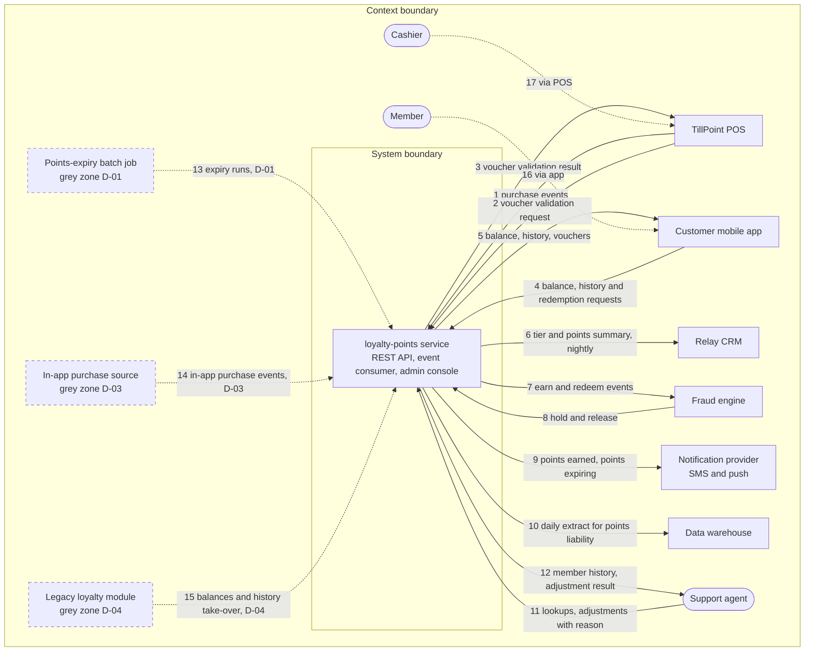

# System context: loyalty-points

The Harbourline loyalty-points service lets members earn points on purchases, see their balance and history in the customer mobile app and redeem points as vouchers at checkout; support agents look up members and adjust points in its admin console.

Last updated 2026-11-03 by the platform-team engineer (sample loop, non-interactive, drafted from `BRIEF.md`). Status: draft.

## System boundary

What the system does or owns (`inside`), what another system or team does (`outside: <owner>`), and what is not decided yet (`grey zone: D-nn`).

| Capability or responsibility | Side | Source |
| --- | --- | --- |
| Earn points from purchase events sent by the POS | inside | BRIEF.md:7; BRIEF.md:19 |
| Validate vouchers for the POS | inside | BRIEF.md:19 |
| Serve balance, history and redemption to the customer mobile app | inside | BRIEF.md:20 |
| Admin console for member lookups and points adjustments with a reason | inside | BRIEF.md:11; BRIEF.md:25 |
| Send earn and redeem events for fraud scoring and apply the fraud engine's hold or release | inside | BRIEF.md:22 |
| Nightly member tier and points summary for the CRM | inside | BRIEF.md:21 |
| Daily extract for finance (points liability) to the data warehouse | inside | BRIEF.md:24 |
| Deciding when to send points-earned and points-expiring messages | inside | BRIEF.md:23 |
| Delivering SMS and push messages | outside: notification provider | BRIEF.md:23 |
| Fraud scoring | outside: fraud engine (owner TBD) | BRIEF.md:22 |
| Scanning the member QR and applying the voucher at the till | outside: TillPoint POS, operated by the cashier | BRIEF.md:18 |
| Points-expiry batch job | grey zone: D-01 | BRIEF.md:26 |
| Voucher printing at the POS | grey zone: D-02 | BRIEF.md:27 |
| Earning points for purchases made in the app | grey zone: D-03 | BRIEF.md:7; BRIEF.md:20 |
| Taking over balances and history from the legacy loyalty module | grey zone: D-04 | BRIEF.md:7; S-04 |

## Context boundary

What around the system shapes its requirements (`context`), what is deliberately ignored (`irrelevant`, with the reason), and what is not decided yet (`grey zone: D-nn`).

| Aspect | Side | Source |
| --- | --- | --- |
| Members, cashiers, support agents | context | BRIEF.md:17; BRIEF.md:18; BRIEF.md:25 |
| TillPoint POS, customer mobile app, Relay CRM, fraud engine, notification provider, data warehouse | context (context table rows 1 to 12) | BRIEF.md:19-24 |
| Singapore PDPA and data retention policy DRP-2024 | context: rules; details go to `constraints-register` and `source-inventory` (S-05) | BRIEF.md:52; BRIEF.md:64 |
| Programme terms and conditions, draft v3 | context: rules for earning, posting, expiry and redemption (S-01) | BRIEF.md:48; BRIEF.md:58-63 |
| Year-end sale peak, last year about 9,000 purchases per minute across stores | context: operating condition | BRIEF.md:76 |
| Legacy loyalty module in the POS vendor's back office | context: being replaced; source of today's rules (S-04); data take-over is D-04 | BRIEF.md:7; BRIEF.md:51 |
| Points-expiry batch job, run today by the data platform team | grey zone: D-01 | BRIEF.md:26 |
| System that reports in-app purchases | grey zone: D-03 | BRIEF.md:7; BRIEF.md:20 |

## Context diagram

Edge labels carry the `#` of the context-table row. Dotted edges: indirect actors and grey zones.

D-02 (voucher printing) is a capability, not an external element, so it appears in the System boundary table only.

## Context table

One row per data flow. Direction: `in` = to the system, `out` = from the system, `via <element>` = a person who reaches the system only through another system.

| # | External element | Kind | Direction | Data flow | Interface | Owner | Status | Source |
| --- | --- | --- | --- | --- | --- | --- | --- | --- |
| 1 | TillPoint POS | system | in | Purchase events for earning | Purchase event JSON, TillPoint loyalty interface v2.1 (S-02) | POS vendor (SH-09) | confirmed | BRIEF.md:19; BRIEF.md:49 |
| 2 | TillPoint POS | system | in | Voucher validation request | Voucher validation call, interface v2.1 (S-02) | POS vendor (SH-09) | confirmed | BRIEF.md:19; BRIEF.md:49 |
| 3 | TillPoint POS | system | out | Voucher validation result | Response to row 2 | POS vendor (SH-09) | confirmed | BRIEF.md:19 |
| 4 | Customer mobile app | system | in | Balance, history and redemption requests | REST API | App team (owner TBD) | confirmed | BRIEF.md:11; BRIEF.md:20 |
| 5 | Customer mobile app | system | out | Balance, history, issued vouchers | REST API | App team (owner TBD) | confirmed | BRIEF.md:20 |
| 6 | Relay CRM | system | out | Member tier and points summary, nightly | TBD | CRM team (owner TBD) | confirmed | BRIEF.md:21 |
| 7 | Fraud engine | system | out | Earn and redeem events for scoring | TBD | TBD (interest: SH-05) | confirmed | BRIEF.md:22 |
| 8 | Fraud engine | system | in | Hold and release decisions | TBD | TBD (interest: SH-05) | confirmed | BRIEF.md:22 |
| 9 | Notification provider | system | out | Points-earned and points-expiring messages | Provider API (TBD) | TBD | confirmed | BRIEF.md:23 |
| 10 | Data warehouse | system | out | Daily extract for finance (points liability) | TBD | System owner TBD; consumer SH-03 | confirmed | BRIEF.md:24 |
| 11 | Support agent | person | in | Member lookups, points adjustments with a reason code | Admin console | SH-06 | confirmed | BRIEF.md:25; BRIEF.md:63 |
| 12 | Support agent | person | out | Member history, adjustment results | Admin console | SH-06 | confirmed | BRIEF.md:25 |
| 13 | Points-expiry batch job | system | in | Expiry runs | TBD | Data platform team (today) | grey zone: D-01 | BRIEF.md:26 |
| 14 | In-app purchase source | system | in | Purchase events for in-app purchases | TBD | TBD | grey zone: D-03 | BRIEF.md:7; BRIEF.md:20 |
| 15 | Legacy loyalty module | system | in | Member balances and points history at cut-over | TBD | POS vendor back office (owner TBD) | grey zone: D-04 | BRIEF.md:7; BRIEF.md:51 |
| 16 | Member | person | via Customer mobile app | Views balance and history, redeems points | Customer mobile app | SH-01 | confirmed | BRIEF.md:17 |
| 17 | Cashier | person | via TillPoint POS | Scans member QR, applies voucher | TillPoint POS | SH-02 | confirmed | BRIEF.md:18 |

## Open decisions

| ID | Question | Options | Recommended | Owner | Status |
| --- | --- | --- | --- | --- | --- |
| D-01 | Does the loyalty-points service run the points-expiry batch job after go-live, or does the data platform team keep it? | (a) inside: the service expires points itself; (b) outside: the data platform team keeps the job and sends expiry runs to the service | (a): expiry follows the programme terms (S-01) that the service implements, and the legacy module the job runs on is being replaced (BRIEF.md:7) | SH-01, with the data platform team lead (not named yet) | open |
| D-02 | Who produces the printed voucher at the POS? | (a) outside: the POS vendor prints from the validation result; (b) inside: the service supplies the voucher print content | (a): the POS already receives the voucher validation result (BRIEF.md:19) and owns the receipt | SH-01, with SH-09 | open |
| D-03 | Which system sends earn events for purchases made in the app? | (a) the customer mobile app; (b) another order system, which then joins the context; (c) outside: no in-app earning in release 1 | (a): the app is the only system on the app channel in the brief (BRIEF.md:20), but the brief lists no earn flow for it, so the app team must confirm | SH-01 | open |
| D-04 | Does the service take over member balances and history from the legacy loyalty module at cut-over? | (a) inside: one-off migration into the service; (b) outside: balances restart and the legacy module answers history questions until it is switched off | (a): members already hold points earned with the plastic card (BRIEF.md:7); restarting balances is a member-facing decision for the product owner | SH-01, with SH-03 and SH-09 | open |

## Questions and answers

| # | Group | Question | Recommended answer | Answer | Source | Becomes |
| --- | --- | --- | --- | --- | --- | --- |
| 1 | Boundary | Is the admin console part of the loyalty-points service? | Part of it | Part of it: "service (REST API + event consumer) and its admin console" | BRIEF.md:11 | System boundary row |
| 2 | Boundary | Does the points-expiry batch job become ours after go-live? | Ours (S-01) | TBD: the brief lists it as "in or out of scope?" | owner: SH-01 | D-01 |
| 3 | Boundary | Who prints the voucher at the POS? | The POS vendor (BRIEF.md:19) | TBD: the brief asks "POS vendor or us?" | owner: SH-01 | D-02 |
| 4 | Context | Which system sends earn events for in-app purchases? | The customer mobile app | TBD (not asked: non-interactive run) | owner: SH-01 | D-03 |
| 5 | Boundary | Are legacy balances and history migrated into the service at cut-over? | Yes, one-off migration | TBD (not asked: non-interactive run) | owner: SH-01 | D-04 |
| 6 | Owner | Who owns the CRM, notification provider, fraud engine and data warehouse on their side? | none | TBD (not asked: non-interactive run) | owner: SH-08 | open |
| 7 | Data | Which interface carries the CRM summary, the fraud events, the notifications and the warehouse extract (file, API, events)? | none | TBD (not asked: non-interactive run) | owner: SH-08 | open |
