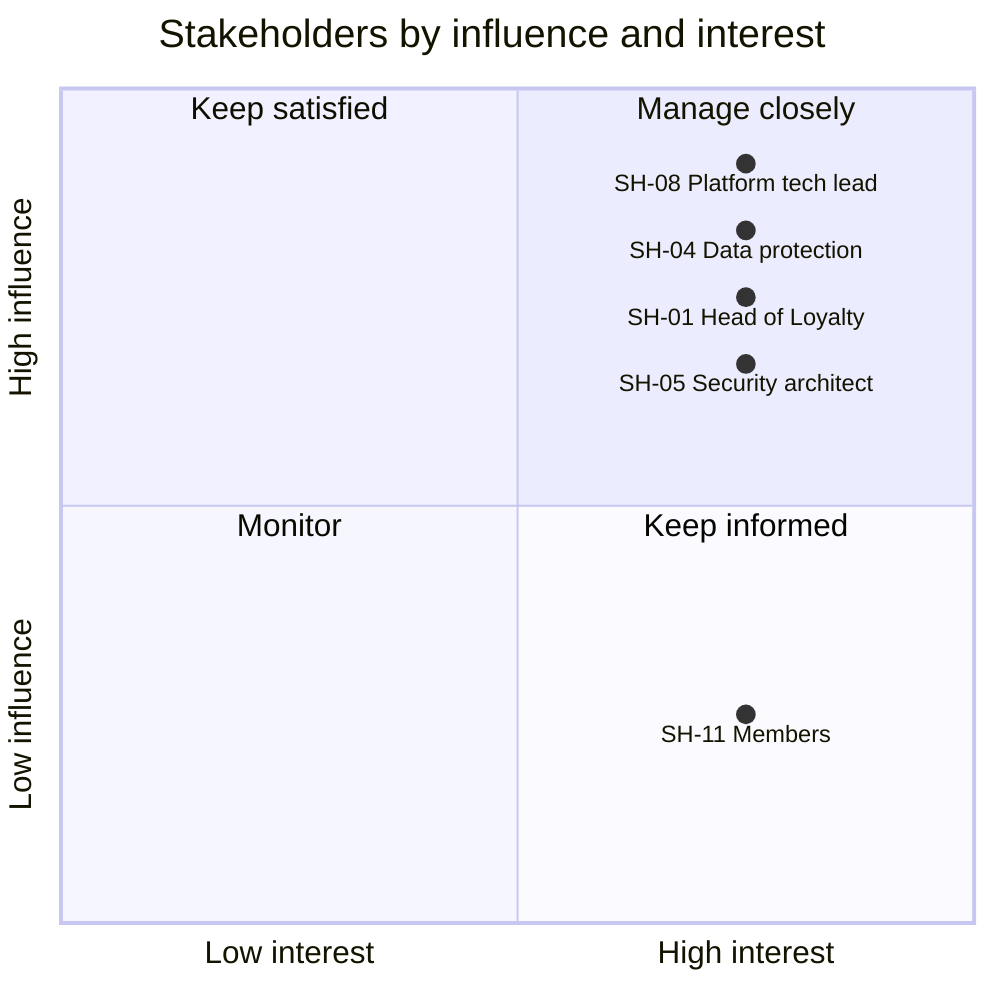

# Stakeholders: loyalty-points

Who has an interest in or influence on loyalty-points, who speaks for them, and how to engage them. Influence and interest are `high` or `low` by the rules of the stakeholder-map skill, `TBD` until someone confirms.

Last updated 2026-11-03 by the platform-team engineer (sample loop, non-interactive, from `BRIEF.md` and `requirements/context.md`).

## Stakeholder table

| ID | Role | Representative | Goals | Influence | Interest | Engagement | Availability | Source |
| --- | --- | --- | --- | --- | --- | --- | --- | --- |
| SH-01 | Head of Loyalty (product owner) | Mei Tan | Programme rules applied as written; member growth | high | high | manage closely | TBD | BRIEF.md:33 |
| SH-02 | Store operations lead | Arjun Pillai | Checkout must not get slower; cashiers trained | TBD | high | TBD | TBD | BRIEF.md:34; BRIEF.md:74 |
| SH-03 | Finance controller | Grace Lim | Correct points-liability accounting and month-end; 12-month expiry; 7-year retention for audit | TBD | high | TBD | TBD | BRIEF.md:35; BRIEF.md:60; BRIEF.md:64 |
| SH-04 | Data protection officer | Farid Osman | PDPA compliance; personal data kept no longer than needed | high | high | manage closely | TBD | BRIEF.md:36; BRIEF.md:64 |
| SH-05 | Security architect | Lena Koh | Fraud, authentication and PCI scope under control; a secure service | high | high | manage closely | TBD | BRIEF.md:37; BRIEF.md:77 |
| SH-06 | Customer support lead | Daniel Ng | Member lookups and adjustments; lower complaint volume | TBD | high | TBD | TBD | BRIEF.md:38 |
| SH-07 | Marketing manager | Priya Raman | Campaigns and bonus-point promotions; an 18-month expiry | TBD | high | TBD | TBD | BRIEF.md:39; BRIEF.md:60 |
| SH-08 | Platform team tech lead | Wei Jie Chua | Operability, cost and the Kubernetes platform; survive the year-end peak | high | high | manage closely | TBD | BRIEF.md:40; BRIEF.md:76 |
| SH-09 | POS vendor integration manager | TBD | Interface changes and release windows | high | TBD | TBD | TBD | BRIEF.md:41 |
| SH-10 | Fraud analyst | TBD | TBD | TBD | TBD | TBD | TBD | BRIEF.md:42; gap check |
| SH-11 | Member (user group) | proxy: S-03 | TBD: the inputs hold no member voice beyond the ticket export | low | high | keep informed | TBD | context.md row 16; gap check |
| SH-12 | Legal counsel for the programme terms | TBD | TBD | TBD | TBD | TBD | TBD | Gap check: programme terms and conditions (S-01) |
| SH-13 | Data platform team lead | TBD | TBD | TBD | TBD | TBD | TBD | BRIEF.md:26; context.md D-01; gap check |

## Power/interest quadrant

The position inside a quadrant carries no meaning; points are spread only so labels stay readable. Not plotted (a rating is TBD): SH-02, SH-03, SH-06, SH-07, SH-09, SH-10, SH-12, SH-13.

## Gap check

| Role | Applies because | Covered by | Gap | Action |
| --- | --- | --- | --- | --- |
| Sponsor or budget owner | always | none named; SH-01 may hold it | unclear | Open question 1 |
| Product owner | always | SH-01 | no | none |
| End users: members | always; members use the app (context table row 16) | SH-11, proxy S-03 | no | Row SH-11 added; open question 4 |
| End users: cashiers | always; cashiers scan the member QR (context table row 17) | SH-02 speaks for store staff | no | none |
| End users: support agents | always; admin console (context table rows 11, 12) | SH-06 | no | none |
| Operations or run team | always; the platform team runs the service (BRIEF.md:7) | SH-08 | no | none |
| QA or test | always | none named | unclear | Open question 5 |
| Owners of external systems | always; `context.md` lists six external systems and three grey-zone elements | SH-09 (POS, no representative yet); app, CRM, fraud engine, notification provider and data warehouse owners not named | yes | Open question 6 |
| Support or service desk | support agents look up members and adjust points (BRIEF.md:25) | SH-06 | no | none |
| Security | points and vouchers have money value; fraud engine holds (BRIEF.md:22) | SH-05 | no | none |
| Data protection | member personal data under PDPA (S-05) | SH-04 | no | none |
| Legal | programme terms and conditions, draft v3 (S-01) | none | yes | Row SH-12 added; open question 7 |
| Finance | points are a liability (BRIEF.md:24, BRIEF.md:35) | SH-03 | no | none |
| Fraud or risk | points and vouchers convert to money; the brief names the fraud analyst as a gap (BRIEF.md:42) | none: SH-05 covers fraud architecture, not case review | yes | Row SH-10 added; open question 8 |
| Audit | 7-year retention of transaction data for audit (BRIEF.md:64) | SH-03 in part | unclear | Open question 9 |
| Architecture or platform | runs on the platform team's Kubernetes platform (BRIEF.md:40) | SH-08 | no | none |
| Marketing or sales | bonus-point promotions (BRIEF.md:39) | SH-07 | no | none |
| Training or change management | cashier training (BRIEF.md:34) | SH-02 | no | none |
| Vendors and partners | TillPoint builds the POS side of the interface (BRIEF.md:19) | SH-09, no representative | yes | Open question 3 |
| People who lose something | the legacy loyalty module is replaced (BRIEF.md:7); the data platform team runs the expiry job today (BRIEF.md:26) | SH-13 (no representative), SH-09 | yes | Row SH-13 added; open question 10 |

Not applicable (trigger not found in the inputs): compliance or regulator liaison (PDPA is covered by SH-04), accessibility (the only member-facing interface is the app team's customer mobile app), works council or union.

## Open questions

| # | Question | Owner | Affects |
| --- | --- | --- | --- |
| 1 | Who owns the budget for the loyalty-points service: Mei Tan, or someone above her? | SH-01 | Sponsor or budget owner |
| 2 | Can the store operations lead, the finance controller, the customer support lead or the marketing manager stop or delay go-live? | SH-01 | SH-02, SH-03, SH-06, SH-07 influence |
| 3 | Who is the named contact at TillPoint for the integration, and does the new voucher validation call change how the vendor works? | SH-02 | SH-09 |
| 4 | Is the support ticket export (S-03) enough as the member voice, or is a member panel or app feedback needed? | SH-01 | SH-11 |
| 5 | Who tests the service and signs off the test results? | SH-08 | QA or test |
| 6 | Who owns the customer mobile app, Relay CRM, the fraud engine, the notification provider and the data warehouse on their side? | SH-08 | Owners of external systems |
| 7 | Who in Legal is responsible for the programme terms and conditions? | SH-01 | SH-12 |
| 8 | Who reviews fraud holds day to day? | SH-05 | SH-10 |
| 9 | Does internal audit review the transaction retention and the points-liability extract, or does Finance cover it? | SH-03 | Audit |
| 10 | Who leads the data platform team that runs the points-expiry job today? | SH-01 | SH-13, D-01 |
| 11 | How and when can each stakeholder be reached (availability is TBD for every row)? | SH-01 | All rows |
