# Trace matrix

| Field | Value |
| --- | --- |
| Generated | 2026-11-03 |
| Commit | 14fa842 |
| Command | `re-lint trace build` |
| Requirements read | `requirements/requirements.csv`, `requirements/stories/redeem-points-at-checkout.md` |
| Code globs | `src/**` |
| Test globs | `tests/**` |

Generated by `re-lint trace build`; rerun it instead of editing this file. Links: `trace.csv`; machine-readable gaps: `gaps.json`.

## Coverage summary

| Measure | Count |
| --- | --- |
| Requirements in scope (not withdrawn or rejected) | 39 |
| ... with a source | 39 |
| ... with a decision or ADR | 3 |
| ... with code or a commit | 6 |
| ... with a test | 8 |
| Gaps: requirements without tests | 2 |
| Gaps: requirements without a source | 0 |
| Gaps: tests citing unknown or retired IDs | 0 |
| Gaps: code citing unknown or retired IDs | 0 |
| Gaps: agreed or later requirements without an implementation reference | 2 |
| Requirements in the register (all statuses) | 39 |
| Trace links | 90 |

## Graph

```mermaid
graph LR
  R001["R-001"]
  BRIEFmd19(["BRIEF.md:19"])
  BRIEFmd19 --> R001
  R002["R-002"]
  BRIEFmd58(["BRIEF.md:58"])
  BRIEFmd58 --> R002
  srcloyaltyearningpy[["src/loyalty/earning.py"]]
  R002 --> srcloyaltyearningpy
  teststestearningpy>"tests/test_earning.py"]
  R002 --> teststestearningpy
  R003["R-003"]
  BRIEFmd58 --> R003
  R004["R-004"]
  BRIEFmd59(["BRIEF.md:59"])
  BRIEFmd59 --> R004
  srcloyaltypostingpy[["src/loyalty/posting.py"]]
  R004 --> srcloyaltypostingpy
  teststestpostingpy>"tests/test_posting.py"]
  R004 --> teststestpostingpy
  R005["R-005"]
  BRIEFmd69(["BRIEF.md:69"])
  BRIEFmd69 --> R005
  R006["R-006"]
  BRIEFmd62(["BRIEF.md:62"])
  BRIEFmd62 --> R006
  R007["R-007"]
  BRIEFmd62 --> R007
  R008["R-008"]
  S06(["S-06"])
  S06 --> R008
  R008 --> srcloyaltypostingpy
  R008 --> teststestpostingpy
  R009["R-009"]
  BRIEFmd22(["BRIEF.md:22"])
  BRIEFmd22 --> R009
  R010["R-010"]
  S06 --> R010
  R011["R-011"]
  S06 --> R011
  R012["R-012"]
  S06 --> R012
  R013["R-013"]
  BRIEFmd61(["BRIEF.md:61"])
  BRIEFmd61 --> R013
  srcloyaltyredemptionpy[["src/loyalty/redemption.py"]]
  R013 --> srcloyaltyredemptionpy
  teststestredemptionpy>"tests/test_redemption.py"]
  R013 --> teststestredemptionpy
  R014["R-014"]
  BRIEFmd61 --> R014
  R014 --> srcloyaltyredemptionpy
  R014 --> teststestredemptionpy
  R015["R-015"]
  S14(["S-14"])
  S14 --> R015
  R016["R-016"]
  S14 --> R016
  R017["R-017"]
  BRIEFmd63(["BRIEF.md:63"])
  BRIEFmd63 --> R017
  R018["R-018"]
  BRIEFmd63 --> R018
  R019["R-019"]
  RDR001{{"RDR-001"}}
  R019 --> RDR001
  S01(["S-01"])
  S01 --> R019
  R020["R-020"]
  BRIEFmd23(["BRIEF.md:23"])
  BRIEFmd23 --> R020
  R020 --> RDR001
  R021["R-021"]
  BRIEFmd25(["BRIEF.md:25"])
  BRIEFmd25 --> R021
  R022["R-022"]
  BRIEFmd21(["BRIEF.md:21"])
  BRIEFmd21 --> R022
  R023["R-023"]
  BRIEFmd24(["BRIEF.md:24"])
  BRIEFmd24 --> R023
  R024["R-024"]
  S14 --> R024
  R024 --> teststestredemptionpy
  R025["R-025"]
  S14 --> R025
  R025 --> teststestredemptionpy
  R026["R-026"]
  S14 --> R026
  R027["R-027"]
  SH02(["SH-02"])
  SH02 --> R027
  R028["R-028"]
  SH01(["SH-01"])
  SH01 --> R028
  R029["R-029"]
  SH08(["SH-08"])
  SH08 --> R029
  R030["R-030"]
  SH08 --> R030
  R031["R-031"]
  SH05(["SH-05"])
  SH05 --> R031
  R032["R-032"]
  SH05 --> R032
  R033["R-033"]
  SH03(["SH-03"])
  SH03 --> R033
  R034["R-034"]
  SH03 --> R034
  R035["R-035"]
  S02(["S-02"])
  S02 --> R035
  R036["R-036"]
  R036 --> RDR001
  S05(["S-05"])
  S05 --> R036
  R037["R-037"]
  S05 --> R037
  R038["R-038"]
  S14 --> R038
  R038 --> srcloyaltyredemptionpy
  R038 --> teststestredemptionpy
  R039["R-039"]
  S14 --> R039
  classDef gap stroke:#d33,stroke-width:3px
  classDef retired stroke-dasharray: 5 5,color:#777
  class R015,R039 gap
```

## Gaps

### Requirements without tests

| ID | Status | Verification | Text |
| --- | --- | --- | --- |
| R-015 | agreed | test | IF the TillPoint POS asks the loyalty service to validate a voucher that is already applied, THEN the loyalty service shall reject the request. |
| R-039 | agreed | test | IF the TillPoint POS asks the loyalty service to validate a voucher code that does not exist, THEN the loyalty service shall reject the request as not found. |

### Requirements without a source

None.

### Tests citing unknown or retired IDs

None.

### Code citing unknown or retired IDs

None.

### Agreed or later requirements without an implementation reference

| ID | Status | Text |
| --- | --- | --- |
| R-015 | agreed | IF the TillPoint POS asks the loyalty service to validate a voucher that is already applied, THEN the loyalty service shall reject the request. |
| R-039 | agreed | IF the TillPoint POS asks the loyalty service to validate a voucher code that does not exist, THEN the loyalty service shall reject the request as not found. |

## Matrix

| Requirement | Status | Sources | Decisions | Code | Tests | Commits | Specs |
| --- | --- | --- | --- | --- | --- | --- | --- |
| R-001 | draft | `BRIEF.md:19` |  |  |  |  |  |
| R-002 | draft | `BRIEF.md:58` |  | `src/loyalty/earning.py` | `tests/test_earning.py::test_r_002_one_point_per_sgd_rounded_down` |  |  |
| R-003 | draft | `BRIEF.md:58` |  |  |  |  |  |
| R-004 | draft | `BRIEF.md:59` |  | `src/loyalty/posting.py` | `tests/test_posting.py::test_r_004_pending_points_not_posted_before_24_hours`, `tests/test_posting.py::test_r_004_pending_points_posted_at_24_hours` |  |  |
| R-005 | draft | `BRIEF.md:69` |  |  |  |  |  |
| R-006 | draft | `BRIEF.md:62` |  |  |  |  |  |
| R-007 | draft | `BRIEF.md:62` |  |  |  |  |  |
| R-008 | draft | `S-06` |  | `src/loyalty/posting.py` | `tests/test_posting.py::test_r_008_points_on_fraud_hold_stay_pending` |  |  |
| R-009 | draft | `BRIEF.md:22` |  |  |  |  |  |
| R-010 | draft | `S-06` |  |  |  |  |  |
| R-011 | draft | `S-06` |  |  |  |  |  |
| R-012 | draft | `S-06` |  |  |  |  |  |
| R-013 | agreed | `BRIEF.md:61` |  | `src/loyalty/redemption.py` | `tests/test_redemption.py::test_r_013_rejects_fewer_than_500_points` |  | `openspec/changes/add-voucher-redemption/.openspec.yaml`, `openspec/changes/add-voucher-redemption/proposal.md`, `openspec/changes/add-voucher-redemption/specs/voucher-redemption/spec.md`, `openspec/changes/add-voucher-redemption/tasks.md` |
| R-014 | agreed | `BRIEF.md:61` |  | `src/loyalty/redemption.py` | `tests/test_redemption.py::test_r_014_voucher_worth_sgd_1_per_100_points` |  | `openspec/changes/add-voucher-redemption/.openspec.yaml`, `openspec/changes/add-voucher-redemption/proposal.md`, `openspec/changes/add-voucher-redemption/specs/voucher-redemption/spec.md`, `openspec/changes/add-voucher-redemption/tasks.md` |
| R-015 | agreed | `S-14` |  |  |  |  | `openspec/changes/add-voucher-redemption/.openspec.yaml`, `openspec/changes/add-voucher-redemption/proposal.md`, `openspec/changes/add-voucher-redemption/specs/voucher-redemption/spec.md`, `openspec/changes/add-voucher-redemption/tasks.md` |
| R-016 | draft | `S-14` |  |  |  |  | `openspec/changes/add-voucher-redemption/proposal.md` |
| R-017 | draft | `BRIEF.md:63` |  |  |  |  |  |
| R-018 | draft | `BRIEF.md:63` |  |  |  |  |  |
| R-019 | draft | `S-01` | `RDR-001` |  |  |  |  |
| R-020 | draft | `BRIEF.md:23` | `RDR-001` |  |  |  |  |
| R-021 | draft | `BRIEF.md:25` |  |  |  |  |  |
| R-022 | draft | `BRIEF.md:21` |  |  |  |  |  |
| R-023 | draft | `BRIEF.md:24` |  |  |  |  |  |
| R-024 | draft | `S-14` |  |  | `tests/test_redemption.py::test_r_024_ac1_convert_500_points`, `tests/test_redemption.py::test_r_024_ac3_fewer_than_500_posted_points`, `tests/test_redemption.py::test_r_024_ac4_pending_points_do_not_count` |  | `openspec/changes/add-voucher-redemption/proposal.md` |
| R-025 | draft | `S-14` |  |  | `tests/test_redemption.py::test_r_025_ac1_convert_a_chosen_amount`, `tests/test_redemption.py::test_r_025_ac3_more_points_than_posted` |  | `openspec/changes/add-voucher-redemption/proposal.md` |
| R-026 | draft | `S-14` |  |  |  |  | `openspec/changes/add-voucher-redemption/proposal.md` |
| R-027 | draft | `SH-02` |  |  |  |  | `openspec/changes/add-voucher-redemption/proposal.md` |
| R-028 | draft | `SH-01` |  |  |  |  |  |
| R-029 | draft | `SH-08` |  |  |  |  |  |
| R-030 | draft | `SH-08` |  |  |  |  |  |
| R-031 | draft | `SH-05` |  |  |  |  | `openspec/changes/add-voucher-redemption/proposal.md` |
| R-032 | draft | `SH-05` |  |  |  |  |  |
| R-033 | draft | `SH-03` |  |  |  |  |  |
| R-034 | draft | `SH-03` |  |  |  |  |  |
| R-035 | draft | `S-02` |  |  |  |  | `openspec/changes/add-voucher-redemption/proposal.md` |
| R-036 | draft | `S-05` | `RDR-001` |  |  |  |  |
| R-037 | draft | `S-05` |  |  |  |  |  |
| R-038 | agreed | `S-14` |  | `src/loyalty/redemption.py` | `tests/test_redemption.py::test_r_038_rejects_more_points_than_posted` |  | `openspec/changes/add-voucher-redemption/.openspec.yaml`, `openspec/changes/add-voucher-redemption/proposal.md`, `openspec/changes/add-voucher-redemption/specs/voucher-redemption/spec.md`, `openspec/changes/add-voucher-redemption/tasks.md` |
| R-039 | agreed | `S-14` |  |  |  |  | `openspec/changes/add-voucher-redemption/.openspec.yaml`, `openspec/changes/add-voucher-redemption/proposal.md`, `openspec/changes/add-voucher-redemption/specs/voucher-redemption/spec.md`, `openspec/changes/add-voucher-redemption/tasks.md` |
