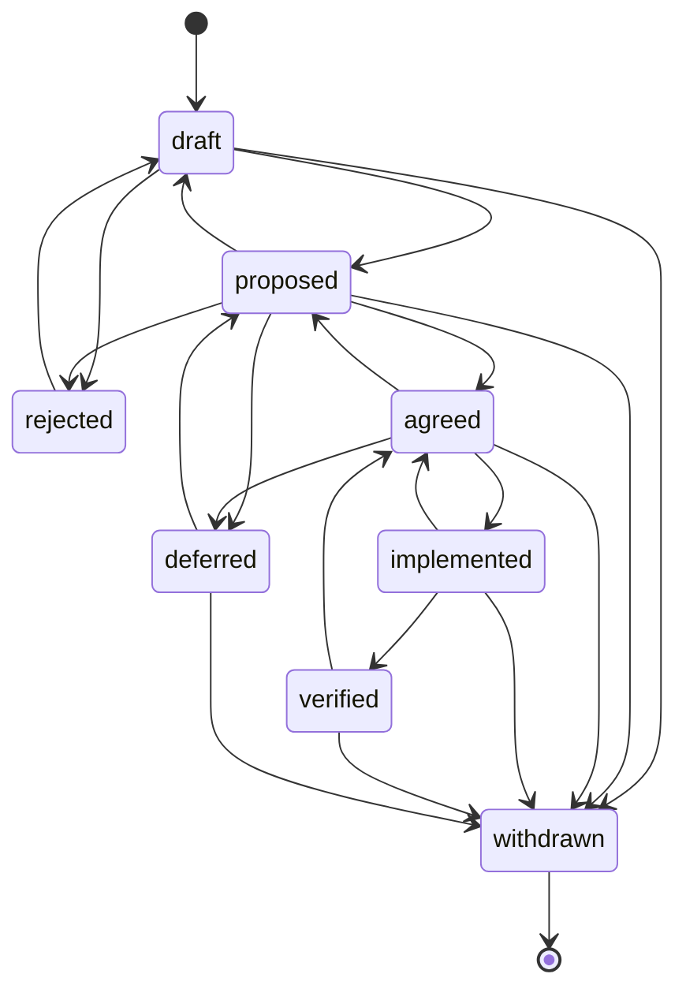

# ID scheme, attributes and lifecycle

Defaults below come from `re-templates/assets/schema.json`. A repo's `requirements/schema.json` overrides them.

## ID kinds

| Kind | Prefix | Digits | Example | Allocated by | Lives in |
| --- | --- | --- | --- | --- | --- |
| `requirement` | `R-` | 3 | `R-012` | every emitting skill | `requirements.csv` |
| acceptance criterion | `<R-ID>.AC` | n | `R-031.AC2` | `user-story-refiner` | `stories/*.md` |
| `source` | `S-` | 2 | `S-04` | `source-inventory` | `sources.csv` |
| `stakeholder` | `SH-` | 2 | `SH-07` | `stakeholder-map` | `stakeholders.md` |
| `interview` | `I-` | 2 | `I-03` | `interview-guide` (`clarifying-questions` answers cite the person and date instead) | `elicitation/interview-*.md` |
| `candidate` | `CAN-` | 3 | `CAN-041` | `artifact-mining`, capture templates | `candidates.csv` |
| `conflict` | `CF-` | 2 | `CF-02` | `conflict-detector` | `conflicts.md` |
| `decision` | `RDR-` | 3 | `RDR-007` | `conflict-to-decision` | `decisions/` |
| `open-decision` | `D-` | 2 | `D-01` | `system-context`, any skill that finds an open boundary or scope question | `context.md`, then an RDR |
| `change` | `CR-` | 3 | `CR-014` | `change-impact` | `changes/` |
| `finding` | `F-` | 2 | `F-05` | `requirements-review` (unique per review file) | `reviews/` |

Rules:

1. IDs are opaque. Never encode type, priority or component in the number.
2. Never reuse an ID, including withdrawn and rejected ones. Never renumber to close gaps.
3. Cite IDs verbatim in commits (`feat: export CSV (R-041)`), test names (`test_r_041_export_masks_pii`) and docs, so `traceability-matrix` can find them.
4. In test function names, the ID may appear as `r_041` or `R041`; the tracer normalizes these.
5. Workshops and observation sessions are cited as `Source` by their work product and date (`workshop-onboarding-ideas 2026-11-05`, `observation-cashier-shadowing 2026-11-06`); register the session in `sources.csv` if it will be cited often.

## Requirement attributes

| Attribute | Required | Values |
| --- | --- | --- |
| `ID` | yes | `R-nnn` |
| `Type` | yes | `F` functional, `Q` quality, `C` constraint |
| `Text` | yes | One requirement per sentence; EARS or story form |
| `Source` | yes | A source ID (`S-03`, `SH-02`, `I-01`), a role and date (`PO 2026-11-03`), or a `file:line` |
| `Priority` | yes | `must`, `should`, `could`, `wont` |
| `Status` | yes | see lifecycle |
| `Rationale` | yes | Why the requirement exists, in one sentence; `TBD` with an open question if unknown |
| `Title` | no | Short label for trackers and views |
| `Owner` | no | Person or role accountable for the requirement |
| `Version` | no | Integer, incremented when `Text` changes |
| `Stability` | no | `stable`, `volatile`, `unknown` |
| `Risk` | no | `high`, `medium`, `low` |
| `Verification` | no | `test`, `inspection`, `analysis`, `demonstration` (set by `testability-check`) |
| `Kano` | no | `dissatisfier`, `satisfier`, `delighter`, `indifferent` |
| `Links` | no | Space-separated IDs or paths: `RDR-007 CF-02 docs/adr/0003-x.md` |
| `Tags` | no | Space-separated free tags |

## Lifecycle

- `agreed` needs a named person in `Source`, `Owner` or a decision record. An agent never sets it on its own.
- `verified` needs evidence: a passing test, an inspection record or a demonstration note referenced in `Links` or `trace/trace.csv`.
- A text change on an `agreed` requirement increments `Version` and moves it back to `proposed`, unless a change request (`CR-nnn`) approved it. An empty `Version` counts as 1.
- An approved change request moves affected `implemented` or `verified` requirements back to `agreed` (the new text still has to be built and verified).

## Change request statuses

`CR-nnn` files carry their own status: `draft → submitted → approved | rejected | deferred`, then `applied` once the affected requirements were updated. Only the change authority named in `requirements/README.md` (`process.change_authority` in `schema.json`) approves.
