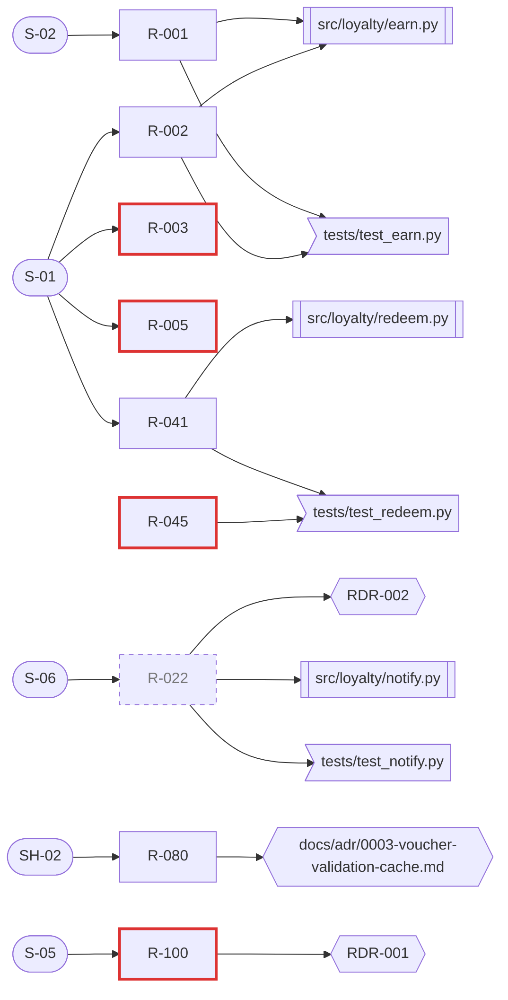

# Trace matrix

| Field | Value |
| --- | --- |
| Generated | 2026-11-03 |
| Commit | 3f9c2ab |
| Command | `re-lint trace build` |
| Requirements read | `requirements/requirements.csv` |
| Code globs | `src/**`, `app/**`, `lib/**`, `pkg/**`, `internal/**`, `cmd/**`, `services/**` |
| Test globs | `tests/**`, `test/**`, `spec/**`, `**/*_test.*`, `**/*.test.*`, `**/*.spec.*`, `**/test_*.py`, `e2e/**` |

Generated by `re-lint trace build`; rerun it instead of editing this file. Links: `trace.csv`; machine-readable gaps: `gaps.json`.

## Coverage summary

| Measure | Count |
| --- | --- |
| Requirements in scope (not withdrawn or rejected) | 7 |
| ... with a source | 7 |
| ... with a decision or ADR | 2 |
| ... with code or a commit | 3 |
| ... with a test | 3 |
| Gaps: requirements without tests | 2 |
| Gaps: requirements without a source | 0 |
| Gaps: tests citing unknown or retired IDs | 2 |
| Gaps: code citing unknown or retired IDs | 1 |
| Gaps: agreed or later requirements without an implementation reference | 3 |
| Requirements in the register (all statuses) | 8 |
| Trace links | 22 |

## Graph

## Gaps

### Requirements without tests

| ID | Status | Verification | Text |
| --- | --- | --- | --- |
| R-003 | agreed | test | WHEN 24 hours have passed since the purchase, the loyalty service shall post the pending points to the member's balance. |
| R-005 | agreed | test | IF the POS reports a return within 24 hours of the purchase, THEN the loyalty service shall reverse the pending points of the original transaction. |

### Requirements without a source

None.

### Tests citing unknown or retired IDs

| Test | Cited ID | Problem | Evidence |
| --- | --- | --- | --- |
| `tests/test_redeem.py::test_r_045_partial_redemption` | R-045 | unknown ID: R-045 is not in the requirement register | `tests/test_redeem.py:18` |
| `tests/test_notify.py::test_r_022_sms_after_posting` | R-022 | retired ID: R-022 is withdrawn | `tests/test_notify.py:4` |

### Code citing unknown or retired IDs

| File or commit | Cited ID | Problem | Evidence |
| --- | --- | --- | --- |
| `src/loyalty/notify.py` | R-022 | retired ID: R-022 is withdrawn | `src/loyalty/notify.py:5` |

### Agreed or later requirements without an implementation reference

| ID | Status | Text |
| --- | --- | --- |
| R-003 | agreed | WHEN 24 hours have passed since the purchase, the loyalty service shall post the pending points to the member's balance. |
| R-005 | agreed | IF the POS reports a return within 24 hours of the purchase, THEN the loyalty service shall reverse the pending points of the original transaction. |
| R-100 | agreed | The loyalty service shall retain points transaction records for 7 years. |

## Matrix

| Requirement | Status | Sources | Decisions | Code | Tests | Commits | Specs |
| --- | --- | --- | --- | --- | --- | --- | --- |
| R-001 | verified | `S-02` |  | `src/loyalty/earn.py` | `tests/test_earn.py::test_r_001_creates_pending_transaction` | `a7d01e4` |  |
| R-002 | implemented | `S-01` |  | `src/loyalty/earn.py` | `tests/test_earn.py::test_r_002_rounds_down_per_transaction` |  |  |
| R-003 | agreed | `S-01` |  |  |  |  |  |
| R-005 | agreed | `S-01` |  |  |  |  |  |
| R-022 | withdrawn | `S-06` | `RDR-002` | `src/loyalty/notify.py` | `tests/test_notify.py::test_r_022_sms_after_posting` |  |  |
| R-041 | implemented | `S-01` |  | `src/loyalty/redeem.py` | `tests/test_redeem.py::test_r_041_rejects_below_minimum` | `3f9c2ab` |  |
| R-045 | not in register |  |  |  | `tests/test_redeem.py::test_r_045_partial_redemption` |  |  |
| R-080 | proposed | `SH-02` | `docs/adr/0003-voucher-validation-cache.md` |  |  |  |  |
| R-100 | agreed | `S-05` | `RDR-001` |  |  |  |  |

## Commits citing requirement IDs

| Commit | Subject |
| --- | --- |
| `3f9c2ab` | feat(redeem): reject redemptions below the minimum (R-041) (#212) |
| `a7d01e4` | feat(earn): create a pending transaction per purchase event (R-001) |
