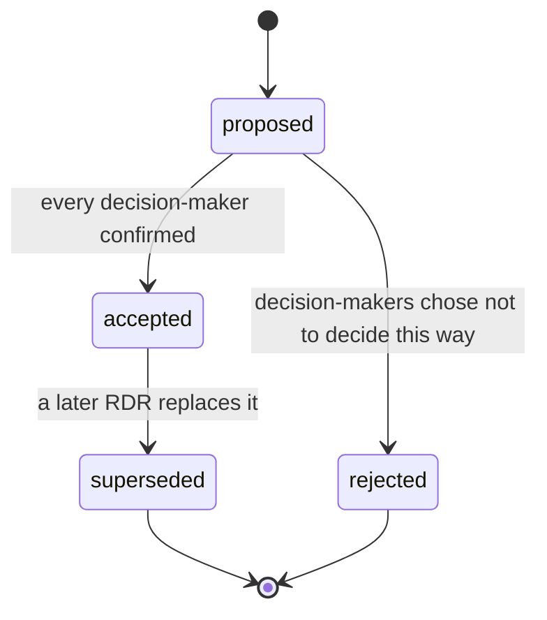

# RDR format

A Requirements Decision Record (RDR) records one decision about requirements. Its headings follow the MADR style used for architecture decision records (Context and Problem Statement, Decision Drivers, Considered Options, Decision Outcome, Consequences, Confirmation, Pros and Cons of the Options, More Information), so an RDR can live in an ADR folder and be read by ADR tooling. The extra sections (Constraints, Facts and assumptions, Requirement Updates) carry what requirements work needs. Read at step 8.

## Header lines

| Line | Fill with |
| --- | --- |
| Status | `proposed` until every decision-maker confirmed; then `accepted`. Later: `superseded by RDR-nnn`. Never delete an RDR. |
| Date | The date the outcome was reached (ISO 8601). |
| Decision-makers | Named people with authority: `Mei Tan (SH-01, product owner)`. Never the agent. |
| Consulted | People whose positions were heard. |
| Informed | People or roles told afterwards. |
| Conflict | `CF-nn (<type>)`, or `unregistered`. |
| Technique | One technique, plus the analysis aid used (`none` if none). |
| Affected requirements | Every R-ID whose Text, Status or Links changes. |
| Supersedes | `RDR-nnn` or `none`. |

## Sections

| Heading | What goes in | Keep it to |
| --- | --- | --- |
| Context and Problem Statement | What conflicts, between whom, why it matters now. End with the decision question. | 2 to 4 sentences |
| Decision Drivers / Constraints | Mandates that bound every option, each with its source (law, policy, contract, deadline). | one row each |
| Decision Drivers / Criteria | What the options are judged on. With a decision matrix: weight, who agreed, when. | one row each |
| Decision Drivers / Facts and assumptions | Consider-all-facts output: fact (with source) or assumption (with who verifies it). | one row each |
| Considered Options | Every option discussed, including the losing positions; for each, the requirement changes it implies. | one line each |
| Decision Outcome | `Chosen option: "<name>", because <reasons tied to drivers>.` Then the confirmation table and dissent. | 1 sentence + table |
| Consequences | `Good, because ...` / `Bad, because ...`, including what the losing side gives up. | 2 to 6 bullets |
| Confirmation | How anyone can check the decision was carried out: requirement updates applied, lint clean, tests in `verification.csv` or `trace/trace.csv`. | 1 to 3 bullets |
| Pros and Cons of the Options | Plus / Minus / Interesting per option; the decision matrix when one was used. | short lists |
| Requirement Updates | One row per affected requirement: change, before, after, applied. | one row each |
| More Information | Open questions with owners, follow-ups, review trigger, related files (`docs/adr/...`, `conflicts.md`, reviews, prototypes). | bullets |

## Status lifecycle

A new decision on the same topic is a new RDR with `Supersedes: RDR-nnn`; the old one gets `Status: superseded by RDR-mmm`. Never edit the outcome of an accepted RDR.

## RDR or ADR?

| The decision is about | Record it as |
| --- | --- |
| What the system shall do or what quality it shall have, between stakeholder positions | RDR in `requirements/decisions/` |
| How the system is built: technology, structure, patterns | ADR in the team's ADR folder (`docs/adr/` or `schema.json` `trace.adr_dirs`) |
| Both (a requirement decision forces a design choice) | RDR for the requirement, ADR for the design; each links the other under More Information |

`traceability-matrix` reads requirement IDs from `requirements/decisions/*.md` and from the ADR folders, so both kinds of record show up in the trace.
