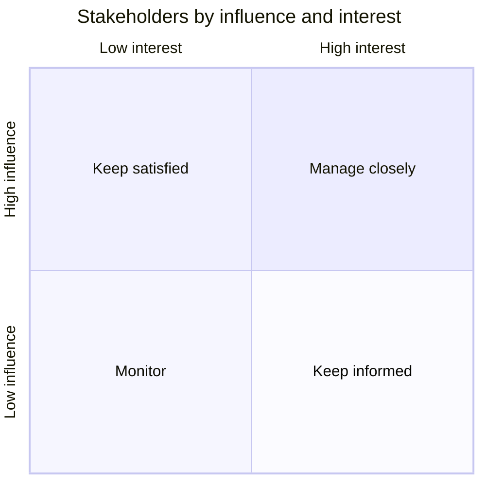

# Stakeholders: {system name}

Who has an interest in or influence on {system name}, who speaks for them, and how to engage them. Influence and interest are `high` or `low` by the rules of the stakeholder-map skill, `TBD` until someone confirms.

Last updated {YYYY-MM-DD} by {name or role}.

## Stakeholder table

| ID | Role | Representative | Goals | Influence | Interest | Engagement | Availability | Source |
| --- | --- | --- | --- | --- | --- | --- | --- | --- |
| {SH-nn} | {role} | {named person, proxy: name or S-nn, or TBD} | {one sentence} | {high / low / TBD} | {high / low / TBD} | {manage closely / keep satisfied / keep informed / monitor / TBD} | {how and when, or TBD} | {file:line, I-nn, or person and date} |

## Power/interest quadrant

The position inside a quadrant carries no meaning; points are spread only so labels stay readable. Not plotted (a rating is TBD): {SH-IDs, or none}.

## Gap check

| Role | Applies because | Covered by | Gap | Action |
| --- | --- | --- | --- | --- |
| {checklist role} | {trigger found in the inputs, or always} | {SH-nn, or none} | {no / yes / unclear} | {none, row added, or open question number} |

Not applicable (trigger not found in the inputs): {roles}.

## Open questions

| # | Question | Owner | Affects |
| --- | --- | --- | --- |
| {n} | {question} | {role or SH-nn} | {SH-IDs or gap roles} |
