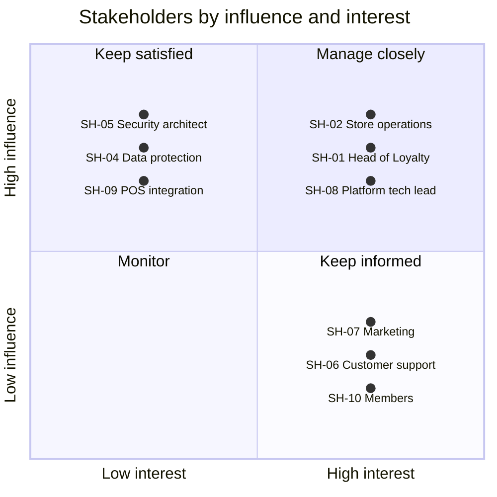

# Stakeholders: loyalty-points

Who has an interest in or influence on loyalty-points, who speaks for them, and how to engage them. Influence and interest are `high` or `low` by the rules of the stakeholder-map skill, `TBD` until someone confirms.

Last updated 2026-11-04 by Wei Jie Chua (SH-08).

## Stakeholder table

| ID | Role | Representative | Goals | Influence | Interest | Engagement | Availability | Source |
| --- | --- | --- | --- | --- | --- | --- | --- | --- |
| SH-01 | Head of Loyalty (product owner) | Mei Tan | Programme rules and member growth | high | high | manage closely | Daily, Slack #loyalty | notes/stakeholder-roster.md:5 |
| SH-02 | Store operations lead | Arjun Pillai | Checkout must not get slower; cashiers trained before rollout | high | high | manage closely | Tue and Thu store visits; 30-minute calls | notes/stakeholder-roster.md:6 |
| SH-03 | Finance controller | Grace Lim | Correct points-liability accounting and a clean month-end close | high | TBD | TBD | Not in month-end week; email otherwise | notes/stakeholder-roster.md:7 |
| SH-04 | Data protection officer | Farid Osman | PDPA compliance and retention | high | low | keep satisfied | Fortnightly privacy clinic | notes/stakeholder-roster.md:8 |
| SH-05 | Security architect | Lena Koh | Fraud, authentication and PCI scope | high | low | keep satisfied | TBD | notes/stakeholder-roster.md:9 |
| SH-06 | Customer support lead | Daniel Ng | Fewer "where are my points" tickets; adjustments | low | high | keep informed | Daily stand-up at 9:15 | notes/stakeholder-roster.md:10 |
| SH-07 | Marketing manager | Priya Raman | Bonus campaigns; a longer points expiry | low | high | keep informed | Wednesday afternoons | notes/stakeholder-roster.md:11 |
| SH-08 | Platform team tech lead | Wei Jie Chua | Operability, cost and the Kubernetes platform | high | high | manage closely | Daily | notes/stakeholder-roster.md:12 |
| SH-09 | TillPoint POS integration manager | TBD | Interface changes and release windows | high | low | keep satisfied | Vendor ticket portal | notes/stakeholder-roster.md:13 |
| SH-10 | Member (user group) | TBD | TBD: no member voice in the inputs | low | high | keep informed | TBD | requirements/context.md (context table row 15); gap check |
| SH-11 | Legal counsel for the programme terms | TBD | TBD | TBD | TBD | TBD | TBD | Gap check: programme terms and conditions (S-01) |
| SH-12 | Fraud analyst | TBD | TBD | TBD | TBD | TBD | TBD | Gap check: points and vouchers convert to money |

## Power/interest quadrant

The position inside a quadrant carries no meaning; points are spread only so labels stay readable. Not plotted (a rating is TBD): SH-03, SH-11, SH-12.

## Gap check

| Role | Applies because | Covered by | Gap | Action |
| --- | --- | --- | --- | --- |
| Sponsor or budget owner | always | SH-01 | no | none |
| Product owner | always | SH-01 | no | none |
| End users: members | always; members use the app and the POS (context table rows 15, 16) | SH-10, no representative | yes | Row SH-10 added; open question 3 |
| End users: cashiers | always; cashiers scan member QR codes (context table row 16) | SH-02 speaks for store staff | no | none |
| End users: support agents | always; admin console (context table rows 11, 12) | SH-06 | no | none |
| Operations or run team | always | SH-08 | no | none |
| QA or test | always | none named | unclear | Open question 4 |
| Owners of external systems | always; `context.md` lists six external systems | SH-09 (POS, no representative yet), SH-05 (fraud engine); app, CRM, notification provider and data warehouse owners not named | yes | Open question 5 |
| Support or service desk | members contact support about points (roster line 10) | SH-06 | no | none |
| Security | points and vouchers have money value; members and staff sign in | SH-05 | no | none |
| Data protection | member personal data under PDPA (S-05) | SH-04 | no | none |
| Legal | programme terms and conditions (S-01) | none | yes | Row SH-11 added; open question 6 |
| Finance | points are a liability (roster line 7) | SH-03 | no | none |
| Fraud or risk | points and vouchers convert to money | none: SH-05 owns the fraud engine, not the review of fraud cases | yes | Row SH-12 added; open question 7 |
| Audit | retention policy DRP-2024 serves audit (S-05) | SH-03 in part | unclear | Open question 8 |
| Architecture or platform | runs on the platform team's Kubernetes platform (roster line 12) | SH-08 | no | none |
| Marketing or sales | bonus campaigns (roster line 11) | SH-07 | no | none |
| Training or change management | cashiers learn the QR flow (roster line 6) | SH-02 | no | none |
| Vendors and partners | TillPoint builds the POS side of the interface | SH-09, no representative | yes | Open question 2 |
| People who lose something | the legacy loyalty module is being replaced (`context.md`, D-01) | none | unclear | Open question 9 |

Not applicable (trigger not found in the inputs): compliance or regulator liaison, accessibility (the only member-facing interface is the app team's), works council or union.

## Open questions

| # | Question | Owner | Affects |
| --- | --- | --- | --- |
| 1 | Does the loyalty-points service change Finance's work, or the measures Finance is judged on, beyond the month-end report? | SH-03 | SH-03 interest |
| 2 | Who is the named contact at TillPoint for the integration? | SH-02 | SH-09 |
| 3 | Who speaks for members: a proxy such as SH-06 with the support ticket export (S-03), a member panel, or feedback sources only? | SH-01 | SH-10 |
| 4 | Who tests the service and signs off the test results? | SH-08 | QA or test |
| 5 | Who owns the customer mobile app, Relay CRM, the notification provider and the data warehouse on their side? | SH-08 | Owners of external systems |
| 6 | Who in Legal is responsible for the programme terms and conditions? | SH-01 | SH-11 |
| 7 | Who reviews fraud holds day to day? | SH-05 | SH-12 |
| 8 | Does internal audit review the points-liability extract and the retention, or does Finance cover it? | SH-03 | Audit |
| 9 | Who maintains the legacy loyalty module today, and what do they need from the migration? | SH-08 | People who lose something |
| 10 | How and when can Lena Koh be reached for security reviews? | SH-05 | SH-05 availability |
