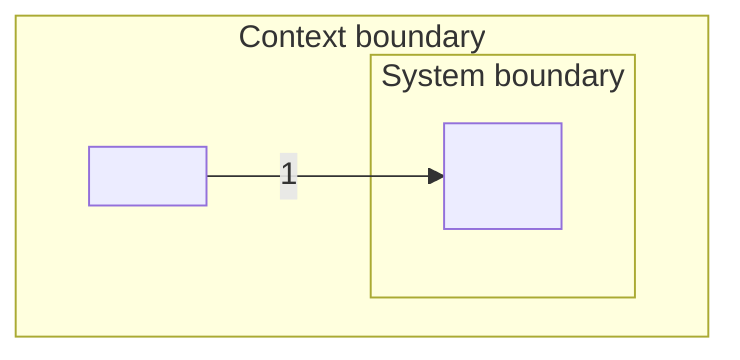

# System context: {system name}

{One sentence: what the system does and for whom.}

Last updated {YYYY-MM-DD} by {name or role}. Status: draft.

## System boundary

What the system does or owns (`inside`), what another system or team does (`outside: owner`), and what is not decided yet (`grey zone: D-nn`).

| Capability or responsibility | Side | Source |
| --- | --- | --- |
| {capability} | {inside / outside: owner / grey zone: D-nn} | {S-nn, I-nn, person and date, or file:line} |

## Context boundary

What around the system shapes its requirements (`context`), what is deliberately ignored (`irrelevant`, with the reason), and what is not decided yet (`grey zone: D-nn`).

| Aspect | Side | Source |
| --- | --- | --- |
| {person role, system, organization, rule or operating condition} | {context / irrelevant: reason / grey zone: D-nn} | {source} |

## Context diagram

Edge labels carry the `#` of the context-table row. Dotted edges: indirect actors and grey zones.

## Context table

One row per data flow. Direction: `in` = to the system, `out` = from the system, `via <element>` = a person who reaches the system only through another system.

| # | External element | Kind | Direction | Data flow | Interface | Owner | Status | Source |
| --- | --- | --- | --- | --- | --- | --- | --- | --- |
| {n} | {role or system name} | {person / system / organization} | {in / out / via element} | {what flows} | {REST, events, batch file, UI, ... or TBD} | {team, role or SH-nn that owns the system or represents the people, or TBD} | {confirmed / assumed / grey zone: D-nn} | {source} |

## Open decisions

| ID | Question | Options | Recommended | Owner | Status |
| --- | --- | --- | --- | --- | --- |
| {D-nn} | {boundary question} | {(a) ...; (b) ... (one option is "outside")} | {option and why} | {role or SH-nn} | {open / decided: answer (who, date) / RDR-nnn} |

## Questions and answers

| # | Group | Question | Recommended answer | Answer | Source | Becomes |
| --- | --- | --- | --- | --- | --- | --- |
| {n} | {Boundary / Context / Data / Owner} | {question} | {recommendation} | {answer or TBD} | {who, date, or owner: role} | {row, D-nn, or open} |
