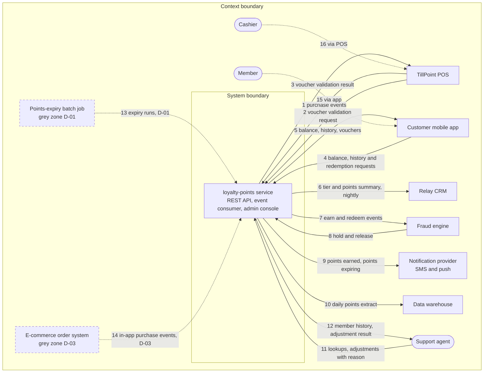

# System context: loyalty-points

The Harbourline loyalty-points service lets members earn points on purchases, see their balance and history in the customer mobile app, and redeem points as vouchers at the POS; support agents manage members in its admin console.

Last updated 2026-11-03 by Wei Jie Chua (SH-08). Status: draft.

## System boundary

What the system does or owns (`inside`), what another system or team does (`outside: owner`), and what is not decided yet (`grey zone: D-nn`).

| Capability or responsibility | Side | Source |
| --- | --- | --- |
| Earn points from purchase events sent by the POS | inside | notes/kickoff-2026-11-03.md:4 |
| Validate vouchers for the POS | inside | notes/kickoff-2026-11-03.md:4 |
| Serve balance, history and redemption to the customer mobile app | inside | notes/kickoff-2026-11-03.md:5 |
| Admin console for member lookups and points adjustments | inside | notes/kickoff-2026-11-03.md:3; SH-08 2026-11-03 |
| Send earn and redeem events for scoring and apply the fraud engine's hold or release | inside | notes/kickoff-2026-11-03.md:7 |
| Nightly member tier and points summary for the CRM | inside | notes/kickoff-2026-11-03.md:6 |
| Daily points-liability extract for the data warehouse | inside | notes/kickoff-2026-11-03.md:9 |
| Deciding when to send points-earned and points-expiring messages | inside | notes/kickoff-2026-11-03.md:8 |
| Delivering SMS and push messages | outside: notification provider | notes/kickoff-2026-11-03.md:8 |
| Fraud scoring | outside: fraud engine (SH-05) | notes/kickoff-2026-11-03.md:7 |
| Payments and card handling | outside: TillPoint POS | notes/kickoff-2026-11-03.md:14 |
| Points-expiry batch job | grey zone: D-01 | notes/kickoff-2026-11-03.md:11; SH-01 2026-11-03 |
| Voucher printing on the POS receipt | grey zone: D-02 | notes/kickoff-2026-11-03.md:12; SH-01 2026-11-03 |

## Context boundary

What around the system shapes its requirements (`context`), what is deliberately ignored (`irrelevant`, with the reason), and what is not decided yet (`grey zone: D-nn`).

| Aspect | Side | Source |
| --- | --- | --- |
| Members, cashiers, support agents | context | notes/kickoff-2026-11-03.md:4; notes/kickoff-2026-11-03.md:5; notes/kickoff-2026-11-03.md:10 |
| TillPoint POS, customer mobile app, Relay CRM, fraud engine, notification provider, data warehouse | context (context table rows 1 to 10) | notes/kickoff-2026-11-03.md:4-9 |
| Singapore PDPA and retention policy DRP-2024 | context: rules; details go to `constraints-register` and `source-inventory` (S-05) | notes/kickoff-2026-11-03.md:16 |
| Store network outages, during which the POS queues purchase events | context: operating condition | notes/kickoff-2026-11-03.md:15; S-02 |
| Payment terminals and card schemes | irrelevant: the POS sends the purchase total | notes/kickoff-2026-11-03.md:14 |
| E-commerce order system | grey zone: D-03 | notes/kickoff-2026-11-03.md:13; SH-01 2026-11-03 |

## Context diagram

Edge labels carry the `#` of the context-table row. Dotted edges: indirect actors and grey zones.

D-02 (voucher printing) is a capability, not an external element, so it appears in the System boundary table only.

## Context table

One row per data flow. Direction: `in` = to the system, `out` = from the system, `via <element>` = a person who reaches the system only through another system.

| # | External element | Kind | Direction | Data flow | Interface | Owner | Status | Source |
| --- | --- | --- | --- | --- | --- | --- | --- | --- |
| 1 | TillPoint POS | system | in | Purchase events for earning | Events, TillPoint loyalty interface v2.1 | POS vendor (SH-09) | confirmed | S-02; notes/kickoff-2026-11-03.md:4 |
| 2 | TillPoint POS | system | in | Voucher validation request | Synchronous call, interface v2.1 | POS vendor (SH-09) | confirmed | S-02; notes/kickoff-2026-11-03.md:4 |
| 3 | TillPoint POS | system | out | Voucher validation result | Response to row 2 | POS vendor (SH-09) | confirmed | S-02; notes/kickoff-2026-11-03.md:4 |
| 4 | Customer mobile app | system | in | Balance, history and redemption requests | REST API | App team (owner TBD) | confirmed | notes/kickoff-2026-11-03.md:5 |
| 5 | Customer mobile app | system | out | Balance, history, issued vouchers | REST API | App team (owner TBD) | confirmed | notes/kickoff-2026-11-03.md:5 |
| 6 | Relay CRM | system | out | Member tier and points summary, nightly | TBD | CRM team (owner TBD) | confirmed | notes/kickoff-2026-11-03.md:6 |
| 7 | Fraud engine | system | out | Earn and redeem events for scoring | TBD | SH-05 | confirmed | notes/kickoff-2026-11-03.md:7 |
| 8 | Fraud engine | system | in | Hold and release decisions | TBD | SH-05 | confirmed | notes/kickoff-2026-11-03.md:7 |
| 9 | Notification provider | system | out | Points-earned and points-expiring messages | Provider API | TBD | confirmed | notes/kickoff-2026-11-03.md:8 |
| 10 | Data warehouse | system | out | Daily points-liability extract | TBD | System owner TBD; consumer SH-03 | confirmed | notes/kickoff-2026-11-03.md:9 |
| 11 | Support agent | person | in | Member lookups, points adjustments with a reason | Admin console | SH-06 | confirmed | notes/kickoff-2026-11-03.md:10 |
| 12 | Support agent | person | out | Member history, adjustment results | Admin console | SH-06 | confirmed | notes/kickoff-2026-11-03.md:10 |
| 13 | Points-expiry batch job | system | in | Expiry runs | TBD | Data platform team (today) | grey zone: D-01 | notes/kickoff-2026-11-03.md:11 |
| 14 | E-commerce order system | system | in | Purchase events for in-app orders | TBD | TBD | grey zone: D-03 | notes/kickoff-2026-11-03.md:13 |
| 15 | Member | person | via Customer mobile app | Views balance and history, redeems points | Customer mobile app | SH-01 | confirmed | notes/kickoff-2026-11-03.md:5 |
| 16 | Cashier | person | via TillPoint POS | Scans member QR codes | TillPoint POS | SH-02 | confirmed | notes/kickoff-2026-11-03.md:4 |

## Open decisions

| ID | Question | Options | Recommended | Owner | Status |
| --- | --- | --- | --- | --- | --- |
| D-01 | Does the loyalty-points service run the points-expiry batch job after go-live, or does the data platform team keep it? | (a) inside: the service expires points itself; (b) outside: the data platform team keeps the job and sends expiry runs | (a): expiry follows the programme terms (S-01) that the service implements, and the legacy module the job runs on is being replaced | SH-01, with the data platform lead | open |
| D-02 | Who produces the printed voucher on the POS receipt? | (a) outside: the POS prints from the validation result; (b) inside: the service supplies the print content | (a): the validation call already returns the voucher to the POS (S-02) | SH-01, with SH-09 | open |
| D-03 | Which system sends earn events for purchases made in the app? | (a) the customer mobile app; (b) the e-commerce order system, which then joins the context; (c) outside: no in-app earning in release 1 | (b): app orders are fulfilled by the order system (notes line 13) | SH-01 | open |

## Questions and answers

| # | Group | Question | Recommended answer | Answer | Source | Becomes |
| --- | --- | --- | --- | --- | --- | --- |
| 1 | Boundary | Is the admin console part of the loyalty-points service? | Part of it (notes line 3) | Part of it, we build it | SH-08 2026-11-03 | System boundary row |
| 2 | Boundary | Does the points-expiry batch job become ours after go-live? | Ours (S-01) | Not decided | SH-01 2026-11-03 | D-01 |
| 3 | Boundary | Who prints the voucher on the receipt? | The POS (S-02) | Probably the POS, ask the vendor | SH-01 2026-11-03 | D-02 |
| 4 | Context | Does the earn event for app purchases come from the app or from the order system? | The order system (notes line 13) | Depends on the app team's roadmap | SH-01 2026-11-03 | D-03 |
| 5 | Owner | Who owns the CRM interface on the CRM side? | none | TBD | owner: SH-01 | open |
| 6 | Owner | Who owns the notification provider contract? | The platform team | TBD (not asked yet) | owner: SH-08 | open |
| 7 | Data | Which interface carries the CRM summary, the fraud events and the warehouse extract (file, API, events)? | none | TBD (not asked yet) | owner: SH-08 | open |
