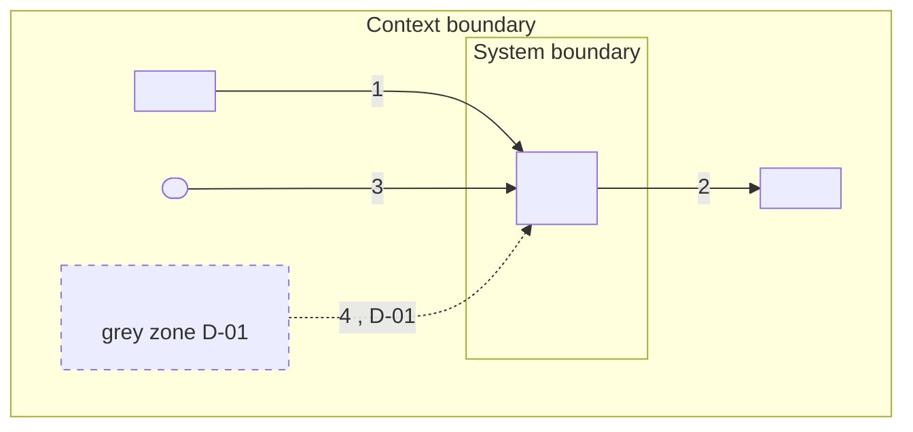
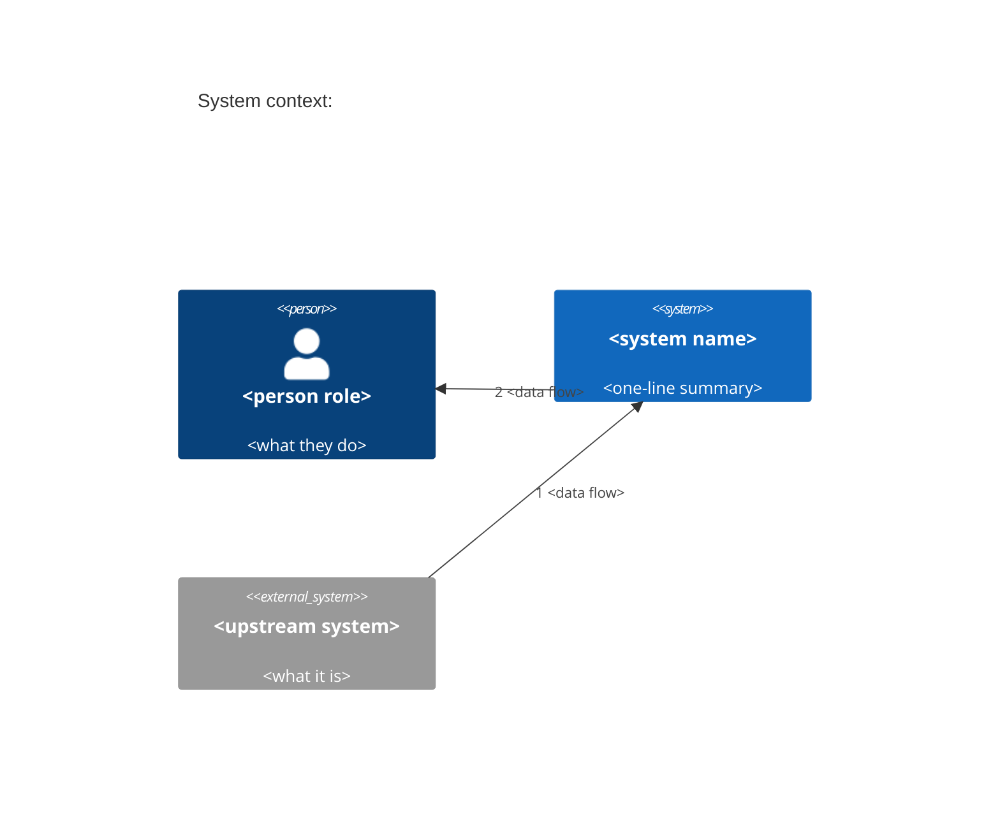

# Context diagram patterns

Mermaid first: it renders in GitHub, GitLab and most editors, and it diffs as text. Use C4 or PlantUML only when the user asks.

## 1. Mermaid flowchart (default)



Rules:

| Rule | Why |
| --- | --- |
| Exactly one node inside the `sys` subgraph: the system under development | A context diagram treats the system as a black box |
| Every external element of the context table is one node inside the `ctx` subgraph | The outer box is the context boundary; anything outside it is irrelevant and not drawn |
| One edge per context-table row, labeled `"<#> <data flow>"` | Table and diagram stay in sync; the number links them |
| Persons use the stadium shape `(["..."])`; systems and organizations use rectangles `["..."]` | Readers tell people from systems at a glance |
| `via` rows (a person who reaches the system through another system) and grey-zone flows use dotted edges `-.->` | Indirect and undecided flows look different from confirmed ones |
| Grey-zone nodes get `class <id> grey`, and their label says `grey zone D-nn` | Undecided scope is visible in the picture |
| More than about 15 external nodes: split into one diagram per interface group, with the system in each | Readability |

Syntax pitfalls that break rendering:

- Put every label in double quotes: `pos["TillPoint POS"]`, `-->|"1 purchase events"|`. Unquoted parentheses, brackets, colons or `#` break the parser.
- Node IDs are short, lowercase, letters and digits only (`pos`, `crm2`). Never use `end`, `graph`, `subgraph`, `class` or `style` as an ID.
- Line breaks inside labels are `<br/>`, not `\n`.
- Do not put double quotes inside a label; rephrase instead.

## 2. Mermaid C4 context (on request)



Mermaid's C4 support is marked experimental; GitHub renders it, some editors do not. Keep the flowchart in the file as well when you add a C4 block.

## 3. PlantUML with C4-PlantUML (on request)

```text
@startuml
!include <C4/C4_Context>
title System context: <system name>
Person(user, "<person role>", "<what they do>")
System(sut, "<system name>", "<one-line summary>")
System_Ext(up, "<upstream system>", "<what it is>")
Rel(up, sut, "1 <data flow>")
@enduml
```

Put PlantUML in a fenced `plantuml` block. It needs a PlantUML renderer; say so in the final message.
