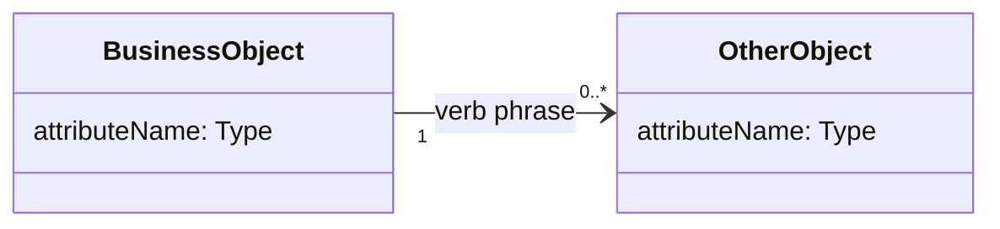

# Domain model: {system or scope}

<!-- Written by the re-skills domain-model skill. Keep every heading, table and column; replace {placeholders}. -->

| Field | Value |
| --- | --- |
| Scope | {system under development; which part of the business the model covers} |
| Notation | {classDiagram or erDiagram} |
| Sources | {requirements read (R-IDs or range), glossary date, other sources} |
| Last checked | {YYYY-MM-DD}, `check_glossary.py` exit {0 or 1}, {n} findings{, with --ignore "..."} |

## Diagram

## Classes

| Class | Glossary term | Meaning | Key attributes | Source |
| --- | --- | --- | --- | --- |
| BusinessObject | {term, or none: G-n} | {one sentence} | {attributeName (Type)} | {R-IDs, glossary, S-nn} |

## Associations

| From | Multiplicity | Association | Multiplicity | To | Source |
| --- | --- | --- | --- | --- | --- |
| BusinessObject | 1 | verb phrase | 0..* | OtherObject | {R-ID or rule; TBD: Qn} |

## Glossary cross-check

| # | Finding | Term or class | Evidence | Proposed action | Raised to |
| --- | --- | --- | --- | --- | --- |
| G1 | {class-without-term, class-named-after-synonym, duplicate-concept, term-without-class, synonym, homonym} | {name} | {R-ID with the word in quotes, file:line, glossary row} | {action} | {glossary, requirement-phrasing, or none: decision recorded} |

Command: `python3 <skill-dir>/scripts/check_glossary.py requirements/models/domain-model.md` (exit {0 or 1}).

## Open questions

| # | Question | Owner | Affects |
| --- | --- | --- | --- |
| Q1 | {question} | {role or SH-nn} | {association, class or R-ID} |
