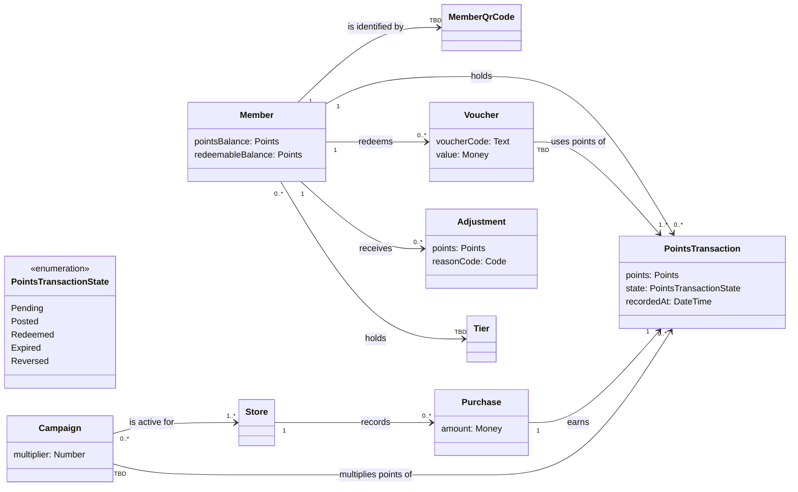

# Domain model: loyalty-points service

<!-- Written by the re-skills domain-model skill. Keep every heading, table and column; replace {placeholders}. -->

| Field | Value |
| --- | --- |
| Scope | loyalty-points service: earning, balances, vouchers, campaigns and support adjustments. No `context.md` and no `schema.json` yet: default schema used. |
| Notation | classDiagram |
| Sources | R-001, R-003, R-004, R-005, R-020, R-021, R-041, R-042, R-065, R-066; requirements/glossary.md as of 2026-11-03 |
| Last checked | 2026-11-03, `check_glossary.py` exit 1, 2 findings, with --ignore "Return window,Cashier" (G1, G2 raised to glossary) |

## Diagram



## Classes

| Class | Glossary term | Meaning | Key attributes | Source |
| --- | --- | --- | --- | --- |
| Member | Member | A person registered in the programme. | pointsBalance (Points, derived), redeemableBalance (Points, derived) | glossary, R-020 |
| MemberQrCode | Member QR code | Identifies a member at the POS. | none known | glossary |
| Store | none: G1 | A Harbourline outlet where purchases are made. | none known | R-004, R-005 |
| Purchase | Purchase | A completed sale reported by the POS. | amount (Money, SGD) | glossary, R-003 |
| PointsTransaction | Points transaction | The points earned for one purchase. | points (Points), state (PointsTransactionState), recordedAt (DateTime) | glossary, R-001, R-005 |
| Campaign | Campaign | A time-limited promotion that multiplies points. | multiplier (Number) | glossary, R-004 |
| Voucher | Voucher | A single-use discount issued for points. | voucherCode (Text, unique), value (Money, SGD 1 per 100 points) | glossary, R-041, R-042 |
| Adjustment | Adjustment | A manual change to a member's points by a support agent. | points (Points), reasonCode (Code) | glossary, R-065, R-066 |
| Tier | none: G2 | The member's tier sent to the CRM; definition TBD (Q4). | none known | R-021 |

`PointsTransactionState` is an enumeration of the states in `state-points-transaction.md`; it is not checked against the glossary.

## Associations

| From | Multiplicity | Association | Multiplicity | To | Source |
| --- | --- | --- | --- | --- | --- |
| Member | 1 | is identified by | TBD | MemberQrCode | glossary; TBD: Q1 |
| Member | 1 | holds | 0..* | PointsTransaction | R-001, R-005 |
| Purchase | 1 | earns | 1 | PointsTransaction | R-001 (one pending transaction per completed purchase event) |
| Store | 1 | records | 0..* | Purchase | R-004, R-005 |
| Campaign | 0..* | is active for | 1..* | Store | R-004 (a campaign is active for a store) |
| Campaign | TBD | multiplies points of | 0..* | PointsTransaction | R-004; TBD: Q2 |
| Member | 1 | redeems | 0..* | Voucher | R-041 |
| Voucher | TBD | uses points of | 1..* | PointsTransaction | R-041; TBD: Q3 |
| Member | 1 | receives | 0..* | Adjustment | R-065 |
| Member | 0..* | holds | TBD | Tier | R-021; TBD: Q4 |

## Glossary cross-check

| # | Finding | Term or class | Evidence | Proposed action | Raised to |
| --- | --- | --- | --- | --- | --- |
| G1 | class-without-term | Store | R-004 "the store of a purchase"; R-005 "the store" | Add the term Store; draft definition: "A Harbourline outlet where purchases are made at a till." | glossary |
| G2 | class-without-term | Tier | R-021 "each customer's tier" | Add the term Tier; definition TBD (Q4). | glossary |
| G3 | term-without-class | Return window | glossary row "Return window" | Not a business object: a rule of PointsTransaction (24 hours), modeled in `state-points-transaction.md`. Ignored in the check. | none: decision recorded |
| G4 | term-without-class | Cashier | glossary row "Cashier" | Not a business object: an actor at the POS; belongs in `context.md` and use cases. Ignored in the check. | none: decision recorded |
| G5 | synonym | customer, Member | R-020 "the customer's points balance"; R-021 "each customer's tier" | Add "customer" as a synonym of Member, or confirm Member as the only term; reword R-020 and R-021 with "member". | glossary, requirement-phrasing |
| G6 | homonym | balance | glossary lists "Balance" as a synonym of Points balance; R-020 asks for "points balance and redeemable balance" | Define Redeemable balance (posted points only) as its own term and drop "Balance" as a synonym of Points balance. | glossary |

Command: `python3 <skill-dir>/scripts/check_glossary.py requirements/models/domain-model.md --ignore "Return window,Cashier"` (exit 1).

```text
requirements/models/domain-model.md: 9 classes (classDiagram); requirements/glossary.md: 11 terms
info: term modeled as attribute: Points balance -> Member.pointsBalance
info: term modeled as attribute: Reason code -> Adjustment.reasonCode
requirements/models/domain-model.md:22: class-without-term: class Store has no glossary entry; raise it to the glossary
requirements/models/domain-model.md:50: class-without-term: class Tier has no glossary entry; raise it to the glossary
2 finding(s)
```

The first run, without `--ignore`, also reported `term-without-class` for Return window and Cashier (G3, G4).

## Open questions

| # | Question | Owner | Affects |
| --- | --- | --- | --- |
| Q1 | Can one member have more than one active QR code (several phones, the legacy plastic card)? | SH-02 Arjun Pillai | Member to MemberQrCode |
| Q2 | Can more than one campaign apply to the same purchase, and if so do the multipliers add or multiply? | SH-07 Priya Raman | Campaign to PointsTransaction, R-004 |
| Q3 | Can one points transaction's points be split across several vouchers (partial redemption)? | SH-01 Mei Tan, SH-03 Grace Lim | Voucher to PointsTransaction |
| Q4 | What is a tier, who assigns it (the loyalty service or the CRM), and does a member always hold exactly one? | SH-01 Mei Tan | Tier, R-021, G2 |
| Q5 | Is an adjustment recorded as a points transaction (with its own state) or kept as a separate record? | SH-06 Daniel Ng, SH-03 Grace Lim | Adjustment, state model |
