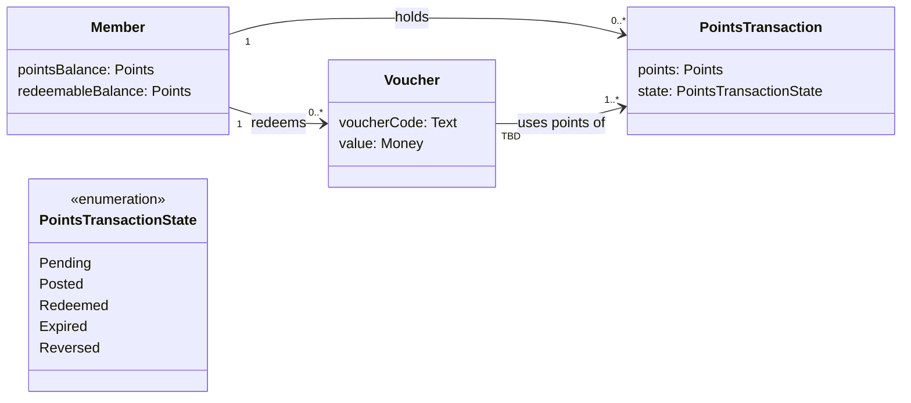
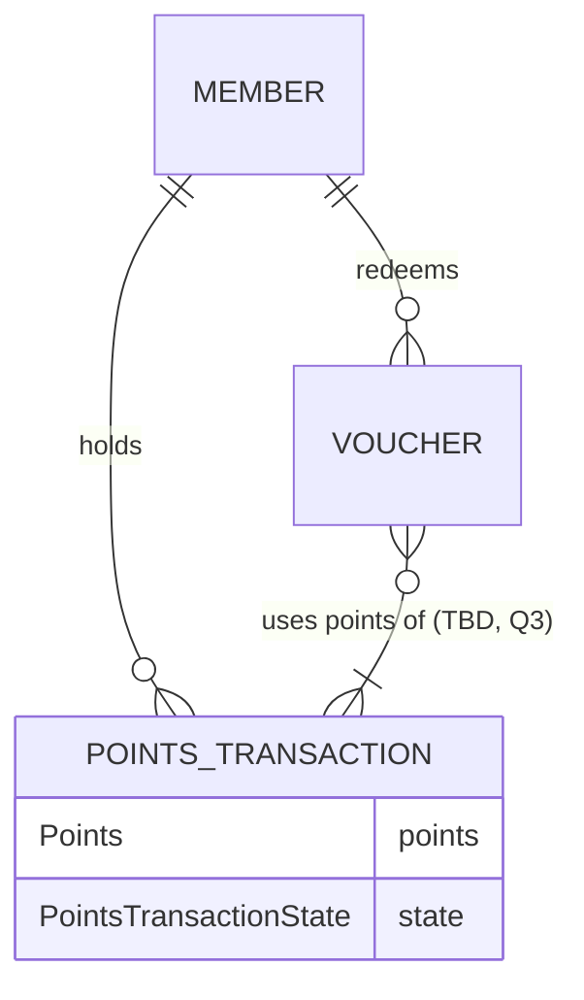
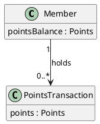

# Mermaid classDiagram and erDiagram subset

Use only what is below. It renders in GitHub, GitLab and Obsidian, and `scripts/check_glossary.py` reads it. Examples are on the loyalty-points sample.

## classDiagram (default)

| Element | Syntax | Rule |
| --- | --- | --- |
| Header | `classDiagram` | First line. `direction LR` keeps wide models readable. |
| Class | `class PointsTransaction` | The glossary term in PascalCase. One class per business object. |
| Class with display name | `class PointsTransaction["Points transaction"]` | Only when the PascalCase name reads badly. The checker matches either name. |
| Attribute | `points: Points` inside `{ }` | `name: Type`, camelCase name, business type. No visibility markers, no methods. |
| Enumeration | `<<enumeration>>` as the first line inside `{ }` | For a fixed value set, typically the states from `state-model`. Not checked against the glossary. |
| Association | `A "1" --> "0..*" B : label` | The arrow gives the reading direction of the label ("Member holds PointsTransaction"), not navigability. Both multiplicities always. |
| Composition | `Voucher "1" *-- "1..*" VoucherLine : contains` | Only when the part cannot exist without the whole. Rare in business models. |
| Generalization | `Adjustment --|> PointsTransaction` | Only when the subtype adds its own attributes or associations, and a source says "an X is a kind of Y". |

Multiplicities, always quoted: `"1"`, `"0..1"`, `"0..*"`, `"1..*"`, `"n..m"` with sourced numbers, or `"TBD"` with an open question. Never `"*"` alone (write `"0..*"`): readers argue about whether it includes zero.

Label rules: a verb phrase from the requirement ("holds", "redeems", "uses points of"). No `:` inside a label. No colors or `classDef`.

## erDiagram (only when asked)

| Element | Syntax | Rule |
| --- | --- | --- |
| Entity | `POINTS_TRANSACTION` | The glossary term in UPPER_SNAKE_CASE (matches the term in the checker). |
| Attribute | `Type name` inside `{ }` | Business type first, then the name. No `PK`, `FK`, `UK` markers: keys are design. |
| Relationship | `A \|\|--o{ B : label` | Left and right symbols: `\|\|` exactly one, `\|o` / `o\|` zero or one, `}o` / `o{` zero or more, `}\|` / `\|{` one or more. |
| Unknown cardinality | `}o` or `o{` at the unknown end, plus `TBD` in the label | erDiagram has no TBD symbol: use the loosest symbol (zero or more) at the end nobody has confirmed, write `TBD` and the question number in the label, and add the open question. |

Prefer classDiagram while any multiplicity is TBD: the quoted `"TBD"` is honest, the loosest crow's foot can be misread as a decision.

## Mapping between the two

| classDiagram | erDiagram |
| --- | --- |
| `"1"` | `\|\|` |
| `"0..1"` | `\|o` / `o\|` |
| `"0..*"` | `}o` / `o{` |
| `"1..*"` | `}\|` / `\|{` |

## PlantUML alternative

Only when the user asks or `schema.json` asks for PlantUML. Keep the Mermaid block as the source of truth: the checker reads Mermaid only.

