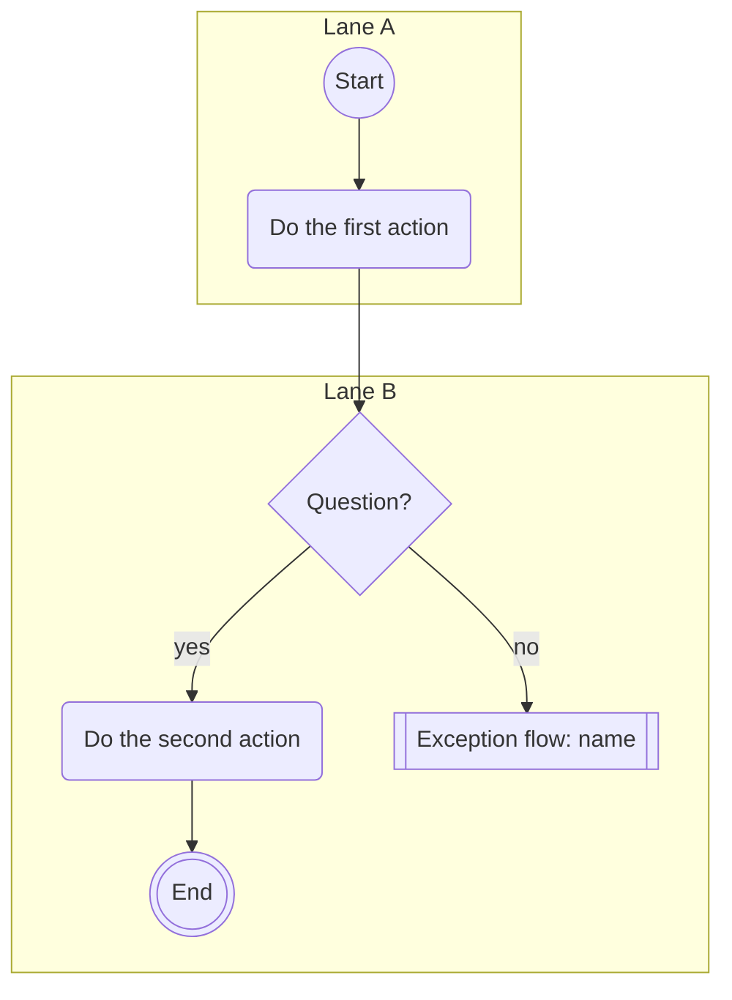
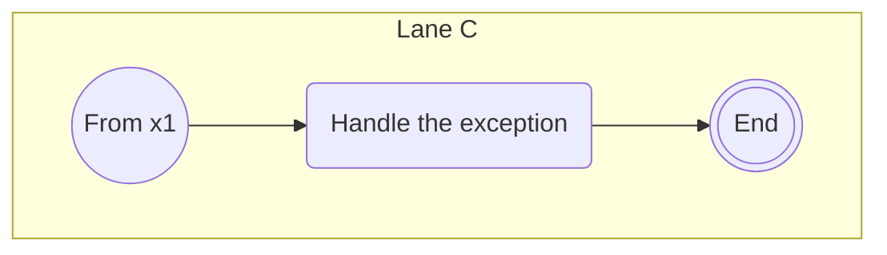

# Process flow: {name}

<!-- Written by the re-skills process-flow skill. Keep every heading, table and column; replace {placeholders}. -->

| Field | Value |
| --- | --- |
| Trigger | {event that starts the flow} |
| Outcome | {what is true when the flow ends normally} |
| Scope | {which part of the process, at what level of detail} |
| Sources | {S-nn, I-nn, SH-nn with date, R-IDs, file:line} |
| Related models | {uc-*.md, state-*.md, or none} |

## Lanes

| Lane | Responsible role or system | Source |
| --- | --- | --- |
| {lane label} | {role or system} | {SH-nn, context.md element, or Unassigned (TBD): Qn} |

## Main flow

## Steps

| Node | Lane | Step | Kind | Requirements |
| --- | --- | --- | --- | --- |
| a1 | {lane} | {verb and object} | action | {R-IDs, candidate C1, or none: not the system's step} |
| d1 | {lane} | {question} | decision | {R-IDs} |
| x1 | {lane} | Exception flow: {name} | exception flow | see below |

## Decisions

| Node | Question | Outcomes (edge labels) | Rule and source |
| --- | --- | --- | --- |
| d1 | {question} | yes; no | {rule, R-ID or source; why any case is not drawn} |

## Exception flows

### Exception flow: {name}

| Field | Value |
| --- | --- |
| Entry | from node {x1} when {condition} |
| Ends | {end node, or rejoins the main flow at node {id}} |

| Node | Lane | Step | Kind | Requirements |
| --- | --- | --- | --- | --- |
| e1 | {lane} | {verb and object} | action | {R-IDs or candidate} |

## Readability check

| Measure | Main flow | {Exception flow name} | Limit |
| --- | --- | --- | --- |
| Action and decision nodes | {n} | {n} | 15 |
| Decisions | {n} | {n} | 3 |
| Longest inline exception path | {n} | {n} | 2 |

## Requirement candidates

| # | Node | Candidate statement | Source | Hand to |
| --- | --- | --- | --- | --- |
| C1 | {node} | {what the system must do, in plain words} | {source} | requirement-phrasing |

## Open questions

| # | Question | Owner | Affects |
| --- | --- | --- | --- |
| Q1 | {question} | {role or SH-nn} | {node, lane or R-ID} |
