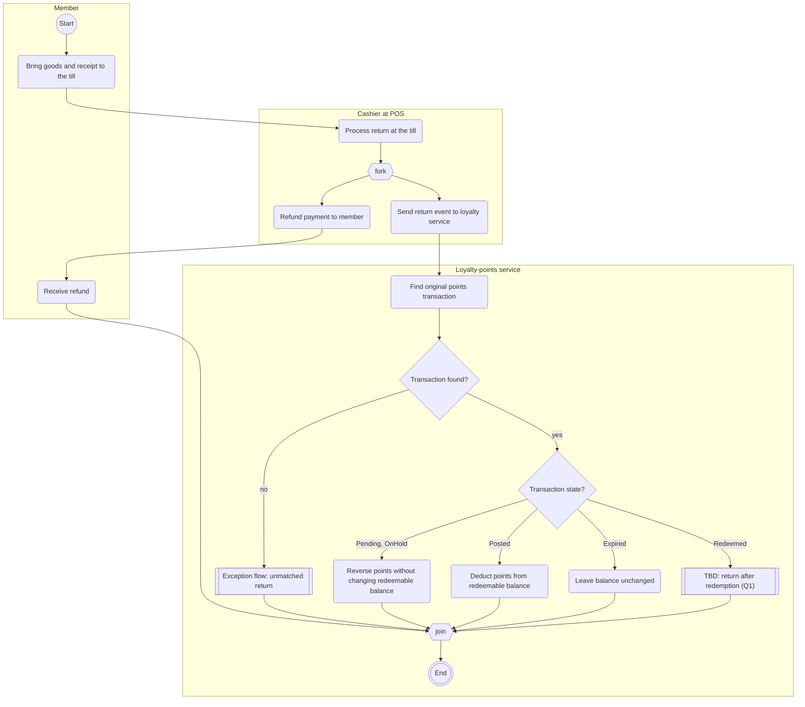
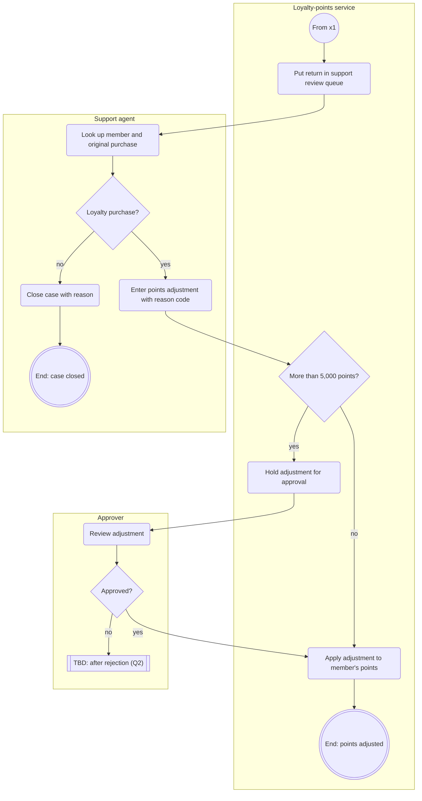

# Process flow: purchase-return

<!-- Written by the re-skills process-flow skill. Keep every heading, table and column; replace {placeholders}. -->

| Field | Value |
| --- | --- |
| Trigger | A customer brings back goods from a purchase that earned points. |
| Outcome | The customer has the refund and the purchase's points are reversed, deducted or confirmed unchanged. |
| Scope | From the till to the member's points, including the support review of returns the loyalty service cannot match. Payment refund details belong to the POS vendor. |
| Sources | I-02 (SH-02, 2026-10-30); SH-06 2026-10-31; R-062 to R-068; requirements/models/state-points-transaction.md |
| Related models | requirements/models/state-points-transaction.md |

## Lanes

| Lane | Responsible role or system | Source |
| --- | --- | --- |
| Member | The member returning goods (Customer in context.md) | context.md |
| Cashier at POS | Cashier using the TillPoint POS at the store till | SH-02, context.md |
| Loyalty-points service | System under development | context.md |
| Support agent | Customer support agent working in the admin console | SH-06, context.md |
| Approver | A second customer support agent who approves adjustments above the limit | SH-06, R-066 |

## Main flow

## Steps

| Node | Lane | Step | Kind | Requirements |
| --- | --- | --- | --- | --- |
| start | Member | Start | start | |
| c1 | Member | Bring goods and receipt to the till | action | none: not the system's step |
| t1 | Cashier at POS | Process return at the till | action | none: POS step (S-02) |
| f1 | Cashier at POS | fork: the refund does not wait for the loyalty service | fork | I-02 |
| t2 | Cashier at POS | Refund payment to member | action | none: POS step |
| c2 | Member | Receive refund | action | none: not the system's step |
| t3 | Cashier at POS | Send return event to loyalty service | action | none: POS step; interface in S-02 |
| s1 | Loyalty-points service | Find original points transaction | action | candidate C1 |
| d1 | Loyalty-points service | Transaction found? | decision | candidate C1 |
| d2 | Loyalty-points service | Transaction state? | decision | R-062, R-063, R-064, R-068 |
| s2 | Loyalty-points service | Reverse points without changing redeemable balance | action | R-062, R-068 |
| s3 | Loyalty-points service | Deduct points from redeemable balance | action | R-063 |
| s4 | Loyalty-points service | Leave balance unchanged | action | R-064 |
| x1 | Loyalty-points service | Exception flow: unmatched return | exception flow | see below |
| q1 | Loyalty-points service | TBD: return after redemption | TBD | Q1 |
| j1 | Loyalty-points service | join | join | |
| done | Loyalty-points service | End | end | |

## Decisions

| Node | Question | Outcomes (edge labels) | Rule and source |
| --- | --- | --- | --- |
| d1 | Transaction found? | yes; no | The return is matched to the points transaction of the original purchase (how: Q4). No match goes to support review (SH-06 2026-10-31). |
| d2 | Transaction state? | Pending, OnHold; Posted; Expired; Redeemed | `state-points-transaction.md`. Reversed is not drawn: impossible, the POS blocks a second return (SH-01 2026-11-02). Redeemed is open (Q1). |

## Exception flows

### Exception flow: unmatched return

| Field | Value |
| --- | --- |
| Entry | from node x1 when no points transaction matches the return |
| Ends | End: points adjusted, or End: case closed; the main flow does not wait for it |

| Node | Lane | Step | Kind | Requirements |
| --- | --- | --- | --- | --- |
| start | Loyalty-points service | From x1 | start | |
| e1 | Loyalty-points service | Put return in support review queue | action | candidate C2 |
| e2 | Support agent | Look up member and original purchase | action | none: agent step in the admin console |
| e3 | Support agent | Loyalty purchase? | decision | SH-06 2026-10-31 |
| e4 | Support agent | Close case with reason | action | candidate C4 |
| closed | Support agent | End: case closed | end | |
| e5 | Support agent | Enter points adjustment with reason code | action | R-065 |
| e6 | Loyalty-points service | More than 5,000 points? | decision | R-066 (does it count deductions? Q3) |
| e7 | Loyalty-points service | Hold adjustment for approval | action | R-066 |
| e8 | Approver | Review adjustment | action | R-066 |
| e9 | Approver | Approved? | decision | R-066 |
| q2 | Approver | TBD: after rejection | TBD | Q2 |
| e10 | Loyalty-points service | Apply adjustment to member's points | action | candidate C3 |
| done | Loyalty-points service | End: points adjusted | end | |

## Readability check

| Measure | Main flow | Unmatched return | Limit |
| --- | --- | --- | --- |
| Action and decision nodes | 11 | 10 | 15 |
| Decisions | 2 | 3 | 3 |
| Longest inline exception path | 0 | 1 | 2 |

The support review path has up to 9 nodes before it ends, more than the inline limit of 2, so it is its own flow (x1). The rejection path (e9 no) stays inline: one TBD node.

## Requirement candidates

| # | Node | Candidate statement | Source | Hand to |
| --- | --- | --- | --- | --- |
| C1 | s1, d1 | When the POS sends a return event, the loyalty service finds the points transaction of the original purchase. | I-02; S-02 | requirement-phrasing |
| C2 | e1 | When a return event matches no points transaction, the loyalty service puts the return in the support review queue. | SH-06 2026-10-31 | requirement-phrasing |
| C3 | e10 | When an adjustment needs no approval, or a second support agent approves it, the loyalty service applies it to the member's points. | SH-06 2026-10-31; R-066 | requirement-phrasing |
| C4 | e4 | A support agent can close a review case with a reason when the purchase was not a loyalty purchase. | SH-06 2026-10-31 | requirement-phrasing |

## Open questions

| # | Question | Owner | Affects |
| --- | --- | --- | --- |
| Q1 | When a purchase is returned after its points were redeemed, what happens: a negative balance, a deduction down to zero, or no loyalty reversal? | SH-01 Mei Tan, SH-03 Grace Lim | d2, q1 |
| Q2 | After the second agent rejects an adjustment, does the case go back to the first agent or close? | SH-06 Daniel Ng | e9, q2 |
| Q3 | Does the 5,000-point limit apply to deductions as well as additions? | SH-06 Daniel Ng, SH-03 Grace Lim | e6, R-066 |
| Q4 | Which field in the return event identifies the original purchase (receipt number, transaction reference)? | SH-09 POS vendor integration manager | s1, C1 |
