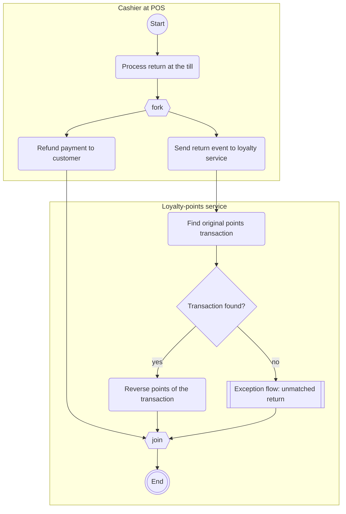
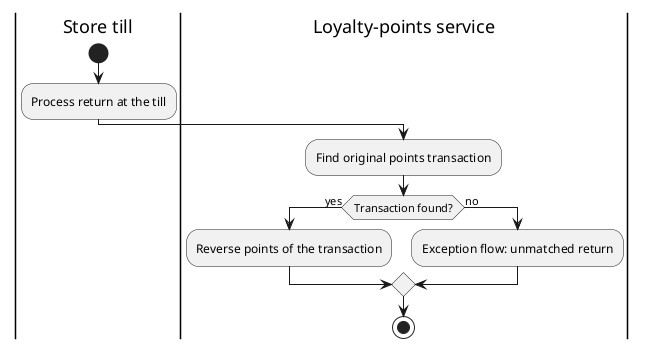

# Activity diagram convention (Mermaid flowchart with swimlanes)

Mermaid has no activity-diagram type, so this skill uses a fixed flowchart convention. It renders in GitHub, GitLab and Obsidian. `use-case-spec` uses the same shapes for its scenario diagrams. Examples are on the loyalty-points sample.

## Shapes

| Element | Mermaid | Rule |
| --- | --- | --- |
| Lane | `subgraph till["Cashier at POS"]` ... `end` | One per responsible role or system, named as `stakeholders.md` or `context.md` does. Keep the label to about 20 characters: Mermaid clips a lane title wider than the lane. The full name goes in the Lanes table. Declare each node inside the lane that does it. |
| Start | `start((Start))` | Exactly one per diagram. |
| End | `done(((End)))`, or `ok(((End: voucher applied)))` | One per distinct outcome; label it when there is more than one. |
| Action | `a1(Refund payment to customer)` | Rounded box. Verb and object, one action. |
| Decision | `d1{Transaction found?}` | A question. Every outgoing edge labeled: `d1 -->\|yes\| a5`. |
| Fork, join | `f1{{fork}}`, `j1{{join}}` | Hexagon labeled `fork` or `join`. Branches after a fork run in parallel with no order between them. Every fork has a join, unless its branches end separately (say so in the Steps table). |
| Exception flow | `x1[["Exception flow: unmatched return"]]` | Double-bordered box. The flow is drawn in its own section under that name. |
| Unknown branch | `t1[["TBD: return after redemption (Q1)"]]` | Same shape. Links to an open question. |
| Flow | `a1 --> a2`; labeled `d1 -->\|no\| x1` | Solid arrow only. Chains (`a --> b --> c`) are fine. |

Rules that keep Mermaid parsing and rendering:

- Node IDs are a letter plus a number (`a1`, `d2`, `f1`, `x1`), unique in the diagram; the Steps table uses them. Lane IDs are words (`till`, `svc`) and never equal a node ID.
- Never use `end` as an ID or as a lowercase label word on its own (Mermaid reserves it); write `done` and `End`.
- Put a label in double quotes when it contains punctuation other than `?` or `-`: `x1[["Exception flow: unmatched return"]]`, `d2 -->|"Pending (R-062)"| a6`. No double quotes inside a label.
- Use `flowchart TB`. No `classDef`, `style` or colors: they do not survive light and dark themes and carry no checkable meaning.
- Mermaid draws each lane as a box, not as aligned parallel bands. When strict bands matter (a printed process map), add the PlantUML version below.

## Readability rule

The main flow, and each exception flow, stays within:

| Measure | Limit |
| --- | --- |
| Action and decision nodes (start, end, fork, join, exception-flow and TBD nodes not counted) | at most 15 |
| Decisions | at most 3 |
| Nodes on an exception path before it ends or rejoins, when drawn inline | at most 2 |

When a limit would be exceeded, move the longest exception path into its own flow and replace it by one `[[Exception flow: name]]` node. Repeat until the main flow fits.

Why these numbers. The Seven Process Modeling Guidelines (7PMG; Mendling, Reijers and van der Aalst, 2010) report that larger models and more routing paths per element go with more errors and worse understanding; they advise using as few elements as possible and decomposing models above about 50 elements. That threshold is for hand-laid-out process models. Mermaid lays out automatically, and with lanes as boxes every extra decision adds edges that cross lanes. We picked 15 nodes and 3 decisions as a working limit, not a standard: small enough to trace the normal path in a rendered Markdown view without zooming when there are three or four lanes. A short exception (reject, then end) is cheaper to read inline than a jump to another section; a longer one doubles the routes a reader must follow from the decision onward, which is the routing-path cost 7PMG warns about. If you exceed a limit on purpose (for example, a regulator wants one picture), say so in the Readability check row.

## Exception flows

- One `### Exception flow: <name>` section per extracted path, with an Entry row (main-flow node and condition) and an Ends row (end node, or the main-flow node where it rejoins).
- Start the exception diagram with `start((From x1))` so the hand-over is visible.
- Exception flows may have their own lanes (for example a support team that does not appear in the main flow).

## PlantUML alternative

Only when the user asks or `schema.json` asks for PlantUML. PlantUML draws real swimlanes (`|Lane|`). Keep the Mermaid block too: it is what renders without a plugin.

Parallel branches in PlantUML: `fork`, `fork again`, `end fork`.
