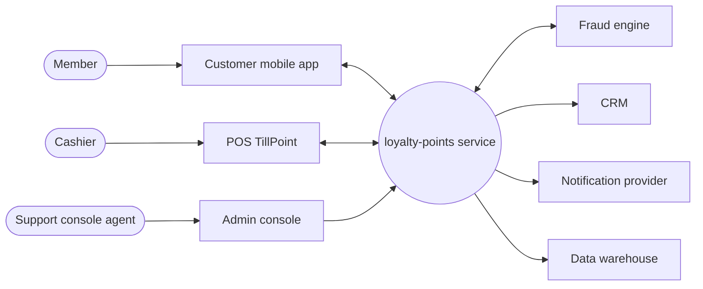

# System context: loyalty-points service

## Context table

| External element | Kind | Interface / data flow |
| --- | --- | --- |
| Customer mobile app | system | App to service: balance, history, redemption |
| POS system (TillPoint) | system | POS to service: purchase events; service to POS: voucher validation |
| CRM | system | Service to CRM: member tier and points summary, nightly |
| Fraud engine | system | Service to fraud engine: earn and redeem events; fraud engine to service: hold and release |
| Notification provider | system | Service to provider: points earned, points expiring |
| Data warehouse | system | Service to warehouse: daily extract for finance |

## Open decisions

| Decision | Question | Owner | Status |
| --- | --- | --- | --- |
| D-01 | Is the points-expiry batch job in or out of scope? | SH-01 | open |
| D-02 | Who prints vouchers at the POS: the POS vendor or us? | SH-01 | open |
