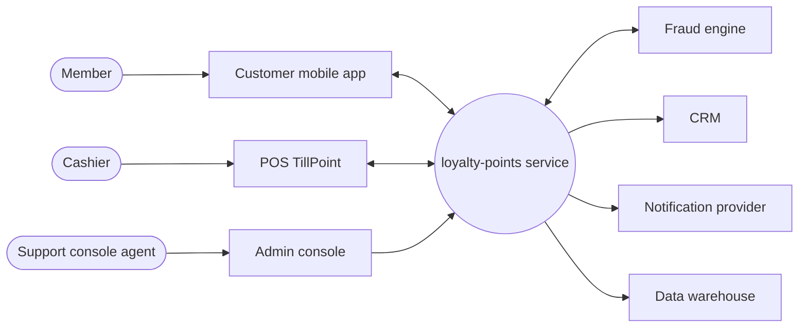

# Loyalty-points service: Software requirements specification

| Field | Value |
| --- | --- |
| Structure | ISO/IEC/IEEE 29148:2018 SRS outline (clause titles only) |
| Version | working copy |
| Date | 2026-11-03 |
| Requirements included | All statuses except withdrawn and rejected; 10 requirements (F 4, Q 3, C 3); 1 excluded (withdrawn) |
| Assembled from | requirements/requirements.csv, requirements/stories/redeem-points-at-checkout.md, requirements/quality-requirements.md, requirements/constraints.csv, requirements/context.md, requirements/glossary.md, requirements/sources.csv |
| Text source | Requirement text is copied verbatim from requirements/requirements.csv; on any difference, requirements.csv wins |
| Open issues | 11, see [5.5 Open issues](#55-open-issues) |

## Contents

- [1 Introduction](#1-introduction)
  - [1.1 Purpose](#11-purpose)
  - [1.2 Scope](#12-scope)
  - [1.3 Product overview](#13-product-overview)
  - [1.4 Definitions](#14-definitions)
- [2 References](#2-references)
- [3 Specific requirements](#3-specific-requirements)
  - [3.1 External interfaces](#31-external-interfaces)
  - [3.2 Functions](#32-functions)
  - [3.3 Usability requirements](#33-usability-requirements)
  - [3.4 Performance requirements](#34-performance-requirements)
  - [3.5 Logical database requirements](#35-logical-database-requirements)
  - [3.6 Design constraints](#36-design-constraints)
  - [3.7 Standards compliance](#37-standards-compliance)
  - [3.8 Software system attributes](#38-software-system-attributes)
  - [3.9 Supporting information](#39-supporting-information)
- [4 Verification](#4-verification)
- [5 Appendices](#5-appendices)
  - [5.1 Assumptions and dependencies](#51-assumptions-and-dependencies)
  - [5.2 Acronyms and abbreviations](#52-acronyms-and-abbreviations)
  - [5.3 Attribute views](#53-attribute-views)
  - [5.4 Traceability](#54-traceability)
  - [5.5 Open issues](#55-open-issues)

## 1 Introduction

### 1.1 Purpose

This specification is the input to the procurement review on 2026-11-10. Finance (Grace Lim, SH-03) and the POS vendor TillPoint (SH-09) price the integration work from it (Mei Tan, SH-01, 2026-11-03).

### 1.2 Scope

The system under development is the loyalty-points service with its admin console. Inside the system boundary: earning, balance and history, redemption with vouchers. Outside: the customer mobile app, the POS, the CRM, the fraud engine, the notification provider and the data warehouse, which exchange data with the service (see [3.1 External interfaces](#31-external-interfaces)). Two scope questions are open: D-01 (points-expiry batch job) and D-02 (voucher printing at the POS); see [5.1 Assumptions and dependencies](#51-assumptions-and-dependencies).

### 1.3 Product overview

#### 1.3.1 Product perspective

The context table is in [3.1 External interfaces](#31-external-interfaces).

#### 1.3.2 Product functions

- Redeem points at checkout (LOY-210): [R-040](#r-040), [R-042](#r-042)
- Other functional requirements: [R-023](#r-023), [R-025](#r-025)

#### 1.3.3 User characteristics

No content in the workspace. Produced by `stakeholder-map` (`requirements/stakeholders.md`).

#### 1.3.4 Limitations

- TillPoint interface v2.1: [R-100](#r-100)
- Member personal data stays in Singapore: [R-103](#r-103)
- Shared Kubernetes platform: [R-104](#r-104)

### 1.4 Definitions

| Term | Definition | Synonyms | Owner |
| --- | --- | --- | --- |
| Member | A registered customer of Harbourline Rewards who earns and redeems points | customer (avoid) | SH-01 |
| Pending points | Points of a purchase during the 24-hour return window; not usable yet | | SH-01 |
| Posted points | Points that passed the return window and can be redeemed | available points | SH-01 |
| Voucher | A code worth SGD 1 per 100 points that a cashier applies at checkout; states Issued, Applied, Expired, Cancelled | | SH-01 |
| POS | The TillPoint point-of-sale system at the till | till | SH-02 |
| PDPA | Personal Data Protection Act (Singapore) | | SH-04 |

## 2 References

| Source | Title | Kind |
| --- | --- | --- |
| S-01 | Harbourline Rewards programme terms and conditions, draft v3 | document |
| S-02 | TillPoint POS loyalty interface spec v2.1 | document |
| S-03 | Support ticket export, last 6 months (loyalty category) | document |
| S-04 | Legacy loyalty module: stored procedures and nightly batch scripts | system |
| S-05 | Singapore PDPA and the data retention policy DRP-2024 | document |

## 3 Specific requirements

### 3.1 External interfaces

| External element | Kind | Interface / data flow |
| --- | --- | --- |
| Customer mobile app | system | App to service: balance, history, redemption |
| POS system (TillPoint) | system | POS to service: purchase events; service to POS: voucher validation |
| CRM | system | Service to CRM: member tier and points summary, nightly |
| Fraud engine | system | Service to fraud engine: earn and redeem events; fraud engine to service: hold and release |
| Notification provider | system | Service to provider: points earned, points expiring |
| Data warehouse | system | Service to warehouse: daily extract for finance |

Constraints on interfaces:

- POS interface: [R-100](#r-100)

### 3.2 Functions

**Redeem points at checkout** (`requirements/stories/redeem-points-at-checkout.md`)

#### R-040

As a member, I want to spend 500 of my posted points as an SGD 5 voucher at the till, so that my points reduce what I pay.

Type F · Priority must · Status draft · Source S-06 (LOY-210)

Rationale: First end-to-end slice of epic LOY-210 (workflow steps, one fixed voucher value); must-have for launch per SH-01.

Acceptance criteria (from `requirements/stories/redeem-points-at-checkout.md`):

**R-040.AC1: Convert 500 points** _(happy path)_
- **Given** a member with 1,200 posted points
- **When** the member asks the app for an SGD 5 voucher
- **Then** the app shows an SGD 5 voucher with a scannable code
- **And** the app shows a posted balance of 700 points

**R-040.AC2: Not enough posted points** _(unwanted behavior)_
- **Given** a member with 300 posted points and 400 pending points
- **When** the member asks the app for an SGD 5 voucher
- **Then** the app refuses the voucher

#### R-042

As a support agent, I want to cancel a member's unused voucher, so that the member gets the points back without a manual points adjustment.

Type F · Priority should · Status draft · Source S-06 (LOY-210)

Rationale: Workflow step split from epic LOY-210 so support can resolve voucher complaints; SH-01 rated it should.

Acceptance criteria (from `requirements/stories/redeem-points-at-checkout.md`):

**R-042.AC1: Cancel an issued voucher** _(happy path)_
- **Given** a member's SGD 5 voucher with status Issued
- **When** the support agent cancels the voucher in the admin console
- **Then** the voucher status becomes Cancelled

**R-042.AC2: Voucher already applied** _(unwanted behavior)_
- **Given** a member's voucher with status Applied
- **When** the support agent tries to cancel the voucher
- **Then** the admin console refuses the cancellation

**Other functional requirements**

#### R-023

WHEN the loyalty service posts points for a purchase, the customer mobile app shall display the updated points balance on the member's next balance request.

Type F · Priority should · Status draft · Source S-06 (LOY-118)

Rationale: Members check the app right after paying; a stale balance drives support tickets (S-03).

#### R-025

IF the fraud engine places a hold on a purchase, THEN the loyalty service shall keep the points of that purchase in pending state until the fraud engine releases the hold.

Type F · Priority must · Status draft · Source S-06 (LOY-118)

Rationale: Prevents fraudulent points from being redeemed before review.

### 3.3 Usability requirements

No requirements in this section.

### 3.4 Performance requirements

#### R-080

WHEN the POS sends a voucher validation request at the planned peak load, the loyalty service shall return the validation result within TBD ms for 95% of requests.

Type Q · Priority must · Status draft · Source S-07 (SH-02 I-02)

Rationale: "Checkout must not get slower" (SH-02); voucher validation is a new call in the checkout path; target is open question Q1.

#### R-082

The loyalty service shall accept TBD purchase events per minute for TBD minutes without losing an event.

Type Q · Priority must · Status draft · Source SH-08 2026-11-03

Rationale: "Must survive the year-end sale peak" (SH-08); last year's peak was 9,000 purchases per minute; planned peak is open question Q3.

### 3.5 Logical database requirements

No content in the workspace. Produced by `domain-model` (`requirements/models/domain-model.md`).

### 3.6 Design constraints

#### R-100

The loyalty service shall exchange purchase events and voucher validation calls with the POS as defined in the TillPoint POS loyalty interface spec v2.1.

Type C · Priority must · Status draft · Source S-02; SH-08 2026-11-03

Rationale: The POS vendor does not change the interface before TillPoint v2.2 (SH-08).

Mandated by POS vendor TillPoint (SH-09) · Mandate reference S-02 (TillPoint POS loyalty interface spec v2.1); SH-08 2026-11-03 · Expires TBD · Review by TBD

#### R-104

The loyalty service shall run on the shared Kubernetes platform.

Type C · Priority must · Status draft · Source SH-08 2026-11-03

Rationale: Platform team standard for every new service; no exceptions in 2026 (SH-08).

Mandated by Platform team, Wei Jie Chua (SH-08) · Mandate reference SH-08 2026-11-03 (verbal; written standard TBD) · Expires TBD · Review by 2026-12-31

### 3.7 Standards compliance

#### R-103

The loyalty service shall store member personal data only in data centers located in Singapore.

Type C · Priority must · Status draft · Source S-05 (DRP-2024); SH-04 2026-11-03

Rationale: The data protection officer requires member personal data to stay in Singapore under DRP-2024.

Mandated by Data protection officer, Farid Osman (SH-04) · Mandate reference S-05 (DRP-2024); SH-04 2026-11-03 · Expires TBD · Review by TBD

### 3.8 Software system attributes

**Security**

#### R-086

The loyalty service shall reject API requests from the POS and the customer mobile app that do not carry valid client credentials.

Type Q · Priority must · Status draft · Source SH-05 2026-11-03

Rationale: "Every call from the tills and the app must be authenticated" (SH-05).

### 3.9 Supporting information

None in the workspace.

## 4 Verification

No content in the workspace. Produced by `testability-check` (`requirements/verification.csv`).

## 5 Appendices

### 5.1 Assumptions and dependencies

| Item | Kind | Owner | Status |
| --- | --- | --- | --- |
| D-01 Is the points-expiry batch job in or out of scope? | open decision (context.md) | SH-01 | open |
| D-02 Who prints vouchers at the POS: the POS vendor or us? | open decision (context.md) | SH-01 | open |
| [R-042](#r-042) depends on [R-040](#r-040) | dependency (stories file) | SH-01 | named |

### 5.2 Acronyms and abbreviations

| Abbreviation | Meaning |
| --- | --- |
| PDPA | Personal Data Protection Act (Singapore) |
| POS | The TillPoint point-of-sale system at the till |

### 5.3 Attribute views

Requirements by type and status:

| Type | draft | Total |
| --- | --- | --- |
| F (functional) | 4 | 4 |
| Q (quality) | 3 | 3 |
| C (constraint) | 3 | 3 |
| Total | 10 | 10 |

Requirements by type and priority:

| Type | must | should | Total |
| --- | --- | --- | --- |
| F (functional) | 2 | 2 | 4 |
| Q (quality) | 3 | 0 | 3 |
| C (constraint) | 3 | 0 | 3 |
| Total | 8 | 2 | 10 |

Excluded from this document: 1 (withdrawn: 1).

### 5.4 Traceability

`trace/trace.csv` not found: backward trace from the Source and Links attributes only. Run `traceability-matrix` for decision, code and test links.

| Requirement | Source | Links |
| --- | --- | --- |
| [R-023](#r-023) | S-06 (LOY-118) | none |
| [R-025](#r-025) | S-06 (LOY-118) | none |
| [R-040](#r-040) | S-06 (LOY-210) | none |
| [R-042](#r-042) | S-06 (LOY-210) | none |
| [R-080](#r-080) | S-07 (SH-02 I-02) | none |
| [R-082](#r-082) | SH-08 2026-11-03 | none |
| [R-086](#r-086) | SH-05 2026-11-03 | none |
| [R-100](#r-100) | S-02; SH-08 2026-11-03 | none |
| [R-103](#r-103) | S-05 (DRP-2024); SH-04 2026-11-03 | none |
| [R-104](#r-104) | SH-08 2026-11-03 | none |

### 5.5 Open issues

| # | Issue | Affects | Owner | Produced by |
| --- | --- | --- | --- | --- |
| 1 | D-01: Is the points-expiry batch job in or out of scope? | [1.2 Scope](#12-scope) | SH-01 | context.md |
| 2 | D-02: Who prints vouchers at the POS: the POS vendor or us? | [1.2 Scope](#12-scope) | SH-01 | context.md |
| 3 | No stakeholder inventory | [1.3.3 User characteristics](#133-user-characteristics) | TBD | `stakeholder-map` |
| 4 | R-080 target is TBD. Q1: What 95th-percentile voucher validation time can the till absorb without checkout getting slower? | [R-080](#r-080) | SH-02 Arjun Pillai with SH-09 | quality-requirements.md |
| 5 | R-082 rate and duration are TBD; R-080 depends on the same peak. Q3: What purchase-event rate must we plan for at this year's year-end peak, and how long does the peak last? | [R-080](#r-080), [R-082](#r-082) | SH-08 Wei Jie Chua with SH-07 Priya Raman | quality-requirements.md |
| 6 | No domain model | [3.5 Logical database requirements](#35-logical-database-requirements) | TBD | `domain-model` |
| 7 | When does TillPoint v2.2 go live, and does v2.1 stay supported after the upgrade? | [R-100](#r-100) | SH-09 | constraints.csv |
| 8 | Where is the platform standard written down, does it continue after 2026, and what happens to a service that does not comply? | [R-104](#r-104) | SH-08 | constraints.csv |
| 9 | Does the rule also cover backups and copies held by the notification provider, can the DPO grant exceptions, and when is DRP-2024 next reviewed or replaced? | [R-103](#r-103) | SH-04 | constraints.csv |
| 10 | No verification methods or acceptance criteria per requirement | [4 Verification](#4-verification) | TBD | `testability-check` |
| 11 | No trace matrix: decision, code and test links are missing | [5.4 Traceability](#54-traceability) | TBD | `traceability-matrix` |
