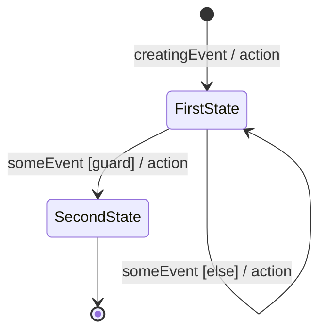

# State model: {Entity}

<!-- Written by the re-skills state-model skill. Keep every heading, table and column; replace {placeholders}. -->

| Field | Value |
| --- | --- |
| Entity | {Entity} (glossary term: {term or TBD}) |
| System | {system under development, from context.md} |
| Sources | {S-nn, I-nn, SH-nn with date, R-IDs, file:line} |
| Related models | {requirements/models/domain-model.md, uc-*.md, flow-*.md, or none} |
| Last checked | {YYYY-MM-DD}, `check_states.py` exit {0 or 1}, {n} findings |

## Diagram

## States

| State | Meaning | Final | Source |
| --- | --- | --- | --- |
| FirstState | {what is true of the entity while it is in this state} | no | {source} |
| SecondState | {meaning} | yes | {source} |

## Events

| Event | Sent by | Meaning | Source |
| --- | --- | --- | --- |
| creatingEvent | {actor, system, or timer} | {what happened; durations TBD unless sourced} | {source} |
| someEvent | {sender} | {meaning} | {source} |

## Transitions

| # | From | Event | Guard | Action | To | Covered by |
| --- | --- | --- | --- | --- | --- | --- |
| T1 | [*] | creatingEvent | | action | FirstState | {R-nnn, or new: R-nnn, or none: Qn} |
| T2 | FirstState | someEvent | guard | action | SecondState | {covered by} |
| T3 | FirstState | someEvent | else | action | FirstState | {covered by} |

## State / event matrix

Every cell is `→ Target` (with its guard, plus `; else ...` when every transition is guarded), `ignored (reason, source)`, `impossible (reason, source)`, or `TBD (Qn)`.

| State / event | someEvent |
| --- | --- |
| FirstState | → SecondState [guard]; else → FirstState |
| SecondState | TBD (Q1) |

## Completeness check

| Check | Result |
| --- | --- |
| Unreachable states | {none, or list} |
| Dead ends | {none, or list} |
| Ambiguous transitions | {none, or list} |
| Matrix gaps | {none, or each cell with its Qn} |
| Matrix and diagram agree | {yes, or the mismatches} |

Command: `python3 <skill-dir>/scripts/check_states.py requirements/models/state-{entity}.md` (exit {0 or 1}).

## Derived requirements

Rows are also appended to `requirements/requirements.csv`; that file wins if the texts differ.

| R-ID | Pattern | Text | From | New or existing |
| --- | --- | --- | --- | --- |
| {R-nnn} | WHILE | WHILE {entity} is {State}, the {system} shall {response}. | State {State} | new |

## Open questions

| # | Question | Owner | Affects |
| --- | --- | --- | --- |
| Q1 | {question} | {role or SH-nn} | {cell, transition or R-ID} |
