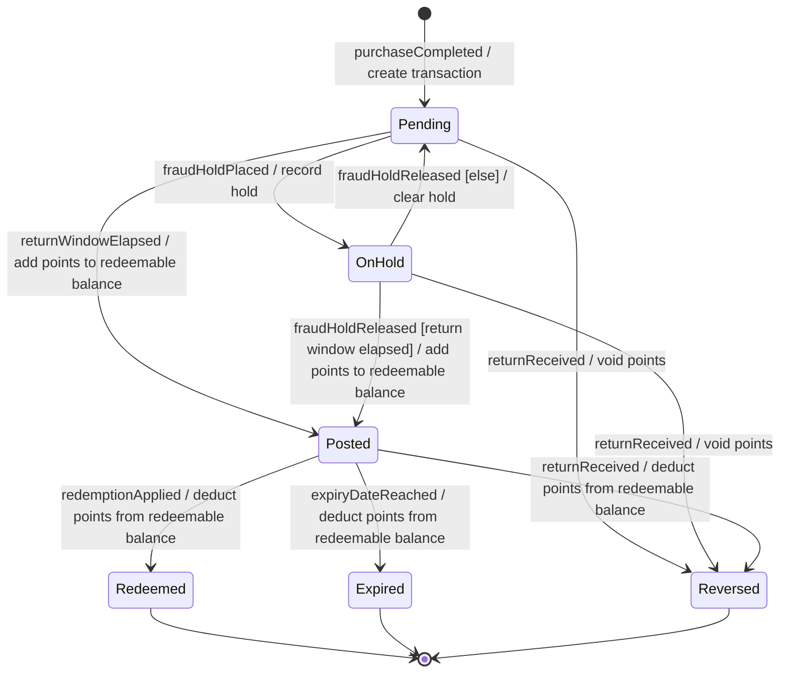

# State model: PointsTransaction

<!-- Written by the re-skills state-model skill. Keep every heading, table and column; replace {placeholders}. -->

| Field | Value |
| --- | --- |
| Entity | PointsTransaction (glossary term: Points transaction) |
| System | loyalty-points service |
| Sources | S-01 (programme terms draft v3), R-001, R-002, R-025, SH-01 2026-11-02, SH-05 2026-11-02 |
| Related models | requirements/models/domain-model.md |
| Last checked | 2026-11-03, `check_states.py` exit 1, 2 findings (matrix gaps Q1 and Q2) |

## Diagram



## States

| State | Meaning | Final | Source |
| --- | --- | --- | --- |
| Pending | The purchase is recorded; its points do not count toward the redeemable balance; the return window runs. | no | S-01, R-001 |
| Posted | The points count toward the redeemable balance; the expiry period runs. | no | S-01, R-002 |
| OnHold | The fraud engine holds the purchase; the points do not count and are not posted, even after the return window ends. R-025 calls this "pending state" (Q6). | no | R-025, SH-05 2026-11-02 |
| Reversed | The purchase was returned; the points are cancelled. | yes | S-01 |
| Redeemed | The points were used for a voucher. | yes | S-01 |
| Expired | The expiry period ended before the points were used. | yes | S-01 |

## Events

| Event | Sent by | Meaning | Source |
| --- | --- | --- | --- |
| purchaseCompleted | TillPoint POS | Completed purchase event for a member; creates the transaction. | R-001, S-02 |
| returnWindowElapsed | loyalty service (timer) | 24 hours have passed since the purchase. | S-01 |
| fraudHoldPlaced | fraud engine | The fraud engine holds the purchase. | R-025 |
| fraudHoldReleased | fraud engine | The fraud engine lifts the hold. | R-025 |
| returnReceived | TillPoint POS | The original purchase was returned at a till. | S-01 |
| redemptionApplied | loyalty service | The transaction's points were used for a voucher. | S-01 |
| expiryDateReached | loyalty service (timer) | The expiry period after posting ended. Length TBD: 12 or 18 months is an open conflict (Q4). | S-01 |

## Transitions

| # | From | Event | Guard | Action | To | Covered by |
| --- | --- | --- | --- | --- | --- | --- |
| T1 | [*] | purchaseCompleted | | create transaction | Pending | R-001 |
| T2 | Pending | returnWindowElapsed | | add points to redeemable balance | Posted | R-002, R-060, R-061 |
| T3 | Pending | fraudHoldPlaced | | record hold | OnHold | R-025 |
| T4 | OnHold | fraudHoldReleased | return window elapsed | add points to redeemable balance | Posted | R-025 |
| T5 | OnHold | fraudHoldReleased | else | clear hold | Pending | R-025 |
| T6 | Pending | returnReceived | | void points | Reversed | new: R-062 |
| T7 | OnHold | returnReceived | | void points | Reversed | new: R-068 |
| T8 | Posted | returnReceived | | deduct points from redeemable balance | Reversed | new: R-063 |
| T9 | Posted | redemptionApplied | | deduct points from redeemable balance | Redeemed | none: Q3 |
| T10 | Posted | expiryDateReached | | deduct points from redeemable balance | Expired | none: Q4 |

## State / event matrix

Every cell is `→ Target` (with its guard, plus `; else ...` when every transition is guarded), `ignored (reason, source)`, `impossible (reason, source)`, or `TBD (Qn)`.

| State / event | returnWindowElapsed | fraudHoldPlaced | fraudHoldReleased | returnReceived | redemptionApplied | expiryDateReached |
| --- | --- | --- | --- | --- | --- | --- |
| Pending | → Posted | → OnHold | impossible (no hold exists, one hold at a time, SH-05 2026-11-02) | → Reversed | impossible (only posted points are redeemable, S-01) | impossible (expiry period starts at posting, S-01) |
| Posted | impossible (fires once, before posting) | impossible (holds only on pending points, SH-05 2026-11-02) | impossible (a hold blocks posting, R-025) | → Reversed | → Redeemed | → Expired |
| OnHold | ignored (stays OnHold; posts on release, R-025) | impossible (one hold at a time, SH-05 2026-11-02) | → Posted [return window elapsed]; else → Pending | → Reversed | impossible (only posted points are redeemable, S-01) | impossible (expiry period starts at posting, S-01) |
| Reversed | impossible (timer stops when the transaction leaves Pending or OnHold) | impossible (holds only on pending points, SH-05 2026-11-02) | TBD (Q2) | impossible (POS blocks a second return, SH-01 2026-11-02) | impossible (only posted points are redeemable, S-01) | impossible (expiry period runs only while Posted) |
| Redeemed | impossible (fires once, before posting) | impossible (holds only on pending points, SH-05 2026-11-02) | impossible (a hold blocks posting, R-025) | TBD (Q1) | impossible (points already used) | impossible (expiry period runs only while Posted) |
| Expired | impossible (fires once, before posting) | impossible (holds only on pending points, SH-05 2026-11-02) | impossible (a hold blocks posting, R-025) | ignored (balance unchanged, SH-01 2026-11-02) | impossible (only posted points are redeemable, S-01) | impossible (fires once) |

## Completeness check

| Check | Result |
| --- | --- |
| Unreachable states | none |
| Dead ends | none |
| Ambiguous transitions | none (OnHold x fraudHoldReleased is split by `[return window elapsed]` and `[else]`) |
| Matrix gaps | 2: Reversed x fraudHoldReleased (Q2); Redeemed x returnReceived (Q1) |
| Matrix and diagram agree | yes |

Command: `python3 <skill-dir>/scripts/check_states.py requirements/models/state-points-transaction.md` (exit 1).

```text
requirements/models/state-points-transaction.md: 6 states, 6 events, 13 transitions
requirements/models/state-points-transaction.md:79: matrix-gap: Reversed x fraudHoldReleased: no transition and not marked 'ignored' or 'impossible' (cell: 'TBD (Q2)')
requirements/models/state-points-transaction.md:80: matrix-gap: Redeemed x returnReceived: no transition and not marked 'ignored' or 'impossible' (cell: 'TBD (Q1)')
2 finding(s)
```

## Derived requirements

Rows are also appended to `requirements/requirements.csv`; that file wins if the texts differ. R-065 and R-066 were already taken, so the IDs skip them.

| R-ID | Pattern | Text | From | New or existing |
| --- | --- | --- | --- | --- |
| R-060 | WHILE | WHILE a points transaction is Pending, the loyalty service shall exclude its points from the member's redeemable balance. | State Pending | new |
| R-061 | WHILE | WHILE a points transaction is Posted, the loyalty service shall include its points in the member's redeemable balance. | State Posted | new |
| R-067 | WHILE | WHILE a points transaction is OnHold, the loyalty service shall exclude its points from the member's redeemable balance. | State OnHold | new |
| R-062 | WHILE, WHEN | WHILE a points transaction is Pending, WHEN the POS sends a return for its purchase, the loyalty service shall reverse the transaction without changing the member's redeemable balance. | Cell Pending x returnReceived (T6) | new |
| R-068 | WHILE, WHEN | WHILE a points transaction is OnHold, WHEN the POS sends a return for its purchase, the loyalty service shall reverse the transaction without changing the member's redeemable balance. | Cell OnHold x returnReceived (T7) | new |
| R-063 | WHILE, WHEN | WHILE a points transaction is Posted, WHEN the POS sends a return for its purchase, the loyalty service shall deduct the transaction's points from the member's redeemable balance. | Cell Posted x returnReceived (T8) | new |
| R-064 | WHILE, WHEN | WHILE a points transaction is Expired, WHEN the POS sends a return for its purchase, the loyalty service shall leave the member's points balance unchanged. | Cell Expired x returnReceived (ignored) | new |
| R-025 | IF, THEN | (existing) Fraud hold keeps the points from being posted until release. | T3, T4, T5; cell OnHold x returnWindowElapsed | existing |

## Open questions

| # | Question | Owner | Affects |
| --- | --- | --- | --- |
| Q1 | When a purchase is returned after its points were redeemed, what happens: the balance goes negative, the deduction stops at zero, or the return is refused for loyalty purposes? | SH-01 Mei Tan, SH-03 Grace Lim | Redeemed x returnReceived |
| Q2 | When the fraud engine releases a hold on a purchase that was already returned (Reversed), should the loyalty service ignore the release, or does something else need to happen (for example telling the fraud engine)? | SH-05 Lena Koh | Reversed x fraudHoldReleased |
| Q3 | Is a points transaction always redeemed whole, or can one voucher use part of its points? If part, Redeemed needs a partial state or redemption is tracked per points lot. Which requirement in R-040 to R-059 covers T9? | SH-01 Mei Tan, SH-03 Grace Lim | T9, domain model |
| Q4 | Expiry period: 12 months (Finance, S-01 draft) or 18 months (Marketing)? Routed to `conflict-detector`; T10 gets its event-driven requirement once decided. | SH-03 Grace Lim, SH-07 Priya Raman | T10, expiryDateReached |
| Q5 | Priority of R-060 to R-064, R-067 and R-068 (nobody stated one; written as TBD). | SH-01 Mei Tan | derived requirements |
| Q6 | R-025 says held points stay "in pending state"; the model separates OnHold from Pending because the return window no longer posts them. Reword R-025 with `requirement-phrasing`, and add OnHold to the glossary? | SH-05 Lena Koh, glossary owner | R-025, OnHold |
