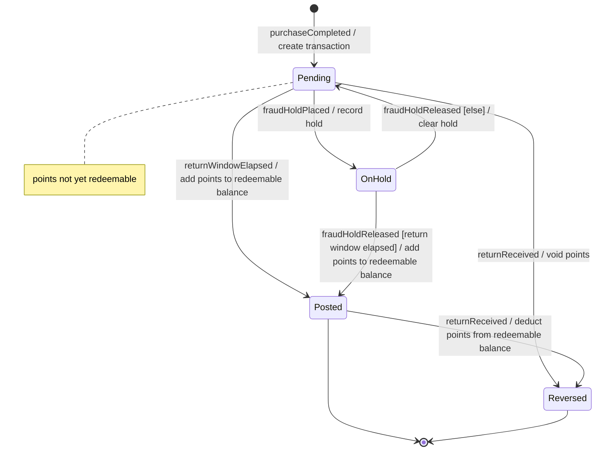
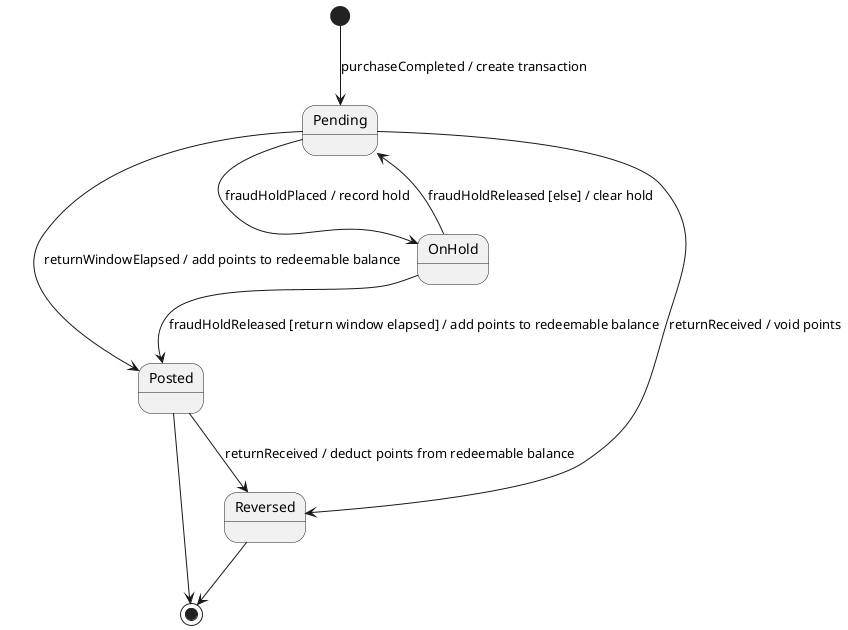

# State diagram syntax (Mermaid stateDiagram-v2 subset)

Use only the subset below. It renders in GitHub, GitLab and Obsidian, and it is exactly what `scripts/check_states.py` reads. The examples are on the loyalty-points sample.

## The subset

| Element | Syntax | Rule |
| --- | --- | --- |
| Header | `stateDiagram-v2` | First line of the block. |
| State | `Pending` | PascalCase identifier: letters, digits, underscore. No spaces or hyphens. The glossary term in PascalCase. |
| State with a display name | `state "On hold" as OnHold` | Only when the display name needs spaces. Matrix rows may use either name. |
| Initial | `[*] --> Pending : creatingEvent / action` | Exactly one initial state. The creating event is not a matrix column. |
| Final | `Expired --> [*]` | Marks `Expired` as final. A final state may still have outgoing transitions. |
| Transition | `From --> To : event [guard] / action` | Every part after the colon is optional: `event`, `event [guard]`, `event / action`, `[guard] / action`. One transition per line. |
| Self-transition | `Posted --> Posted : balanceRequested / report points` | An event that does something but does not change the state. It is not an exit (see dead ends). Mermaid draws only one self-transition per state and silently drops the others; the checker reports `multiple-self-transitions`. |
| Else branch | `OnHold --> Pending : fraudHoldReleased [else] / clear hold` | Complements the other guarded transitions for the same state and event. |
| Completion transition | `Redeemed --> [*]` (no label) | Fires when the state's work is done. Not a matrix column. |
| Note | `note right of Pending : text` or `note left of X` ... `end note` | Ignored by the checker. Keep explanations in the tables instead. |
| Direction | `direction LR` | Optional. Ignored by the checker. |

Label rules:

- Keep labels short; put long explanations in the Transitions table.
- Do not use `:`, `;` or `#` inside a label (Mermaid reads them as syntax), and no `[` or `]` except around the guard.
- No colors or `classDef`: GitHub renders in light and dark themes, and colors carry no meaning a reader can check.

## Not supported (the checker exits 2)

| Construct | Mermaid syntax | Do this instead |
| --- | --- | --- |
| Composite state | `state Active { ... }` | Flatten the sub-states into the main machine, or model the sub-machine as its own entity file. |
| Choice | `state check <<choice>>` | One transition per outcome with mutually exclusive guards, plus `[else]`. |
| Fork / join | `<<fork>>`, `<<join>>` | Parallel behavior across actors belongs in `process-flow`. |
| Concurrent regions | `--` inside a composite state | Split into two entities, one machine each. |

## Naming

| Thing | Form | Good | Avoid |
| --- | --- | --- | --- |
| State | Adjective or past participle from the glossary | `Pending`, `Posted`, `OnHold` | `State1`, `PROCESSING_2`, `isDeleted` |
| Event | camelCase fact, past tense, or a named time event | `returnReceived`, `returnWindowElapsed` | `doReturn`, `after24h` (the number belongs in the Events table, with its source) |
| Guard | Business condition in plain words | `[return window elapsed]`, `[else]` | `[flag == 1]` |
| Action | Verb and object | `/ deduct points from redeemable balance` | `/ UPDATE points SET ...` |

## PlantUML alternative

Only when the user asks or `schema.json` asks for PlantUML. Keep the Mermaid block as the source of truth: the checker reads Mermaid only. The PlantUML transition syntax is the same.

