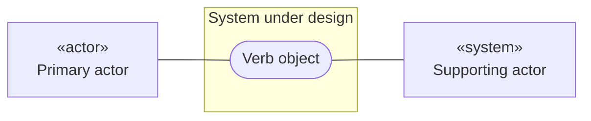
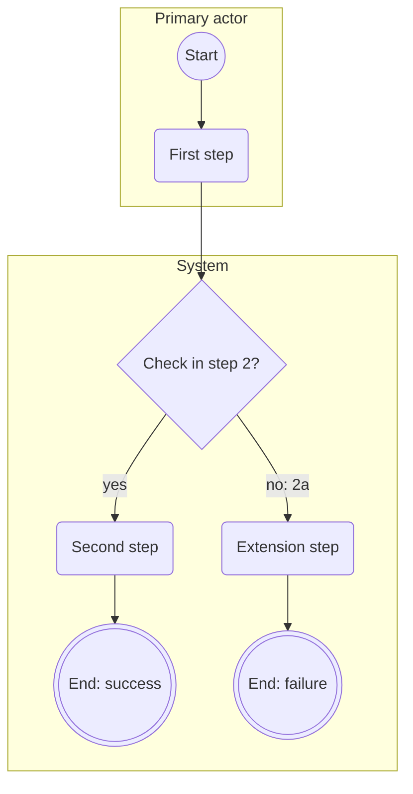

# Use case: {Verb object}

<!-- Written by the re-skills use-case-spec skill. Keep every heading, table and column, in this order; replace {placeholders}. -->

| Field | Value |
| --- | --- |
| Use case | uc-{name} |
| Primary actor | {role} (via {channel, or "directly"}) |
| Supporting actors | {roles and systems, or none} |
| Goal in context | {one sentence from the primary actor's view} |
| Scope | {system under design, as a black box} |
| Level | {user goal, summary, or subfunction} |
| Trigger | {event that starts the use case} |
| Sources | {S-nn, I-nn, SH-nn with date, R-IDs, file:line} |
| Status | draft |

## Stakeholders and interests

| Stakeholder | Interest |
| --- | --- |
| {role or SH-nn} | {what the use case must protect or deliver for them} |

## Preconditions

- {what the system can rely on at the start, or "none"}

## Minimal guarantee

- {what holds even when the goal fails}

## Success guarantee

- {what is true for every stakeholder after success}

## Main success scenario

| Step | Actor | Action | Requirements |
| --- | --- | --- | --- |
| 1 | {primary actor} | {verb and object} | none: actor step |
| 2 | {system} | {verb and object, citing BRn} | {R-nnn, or new: R-nnn} |

## Alternatives

Extensions after which the goal is still reached.

| Ref | Condition | Step | Action | Requirements |
| --- | --- | --- | --- | --- |
| 2a | {condition the system or actor can detect} | 2a1 | {action} | {R-IDs} |
| 2a | | 2a2 | {action}; resume at step {n} | {R-IDs or none} |

## Exceptions

Extensions after which the goal is abandoned; the minimal guarantee holds.

| Ref | Condition | Step | Action | Requirements |
| --- | --- | --- | --- | --- |
| 3a | {condition} | 3a1 | {action}; use case ends in failure | {R-IDs} |

## Business rules

| Rule | Statement | Source |
| --- | --- | --- |
| BR1 | {rule} | {S-nn, R-ID, or person and date} |

## Diagrams

### Use case diagram

### Activity diagram

{Drawn because: more than 3 extensions / a loop / more than one session. Or: "Not drawn: {n} extensions, no loop, one session."}

Not drawn until answered: {extension refs with their Qn, or none}.

## Requirements proposed

Rows are also appended to `requirements/requirements.csv`; that file wins if the texts differ.

| R-ID | Text | Step | Status |
| --- | --- | --- | --- |
| {R-nnn} | {EARS sentence with one shall} | {step or extension ref} | draft |

## Open issues

| # | Question | Owner | Affects |
| --- | --- | --- | --- |
| Q1 | {question} | {role or SH-nn} | {field, step or extension} |
