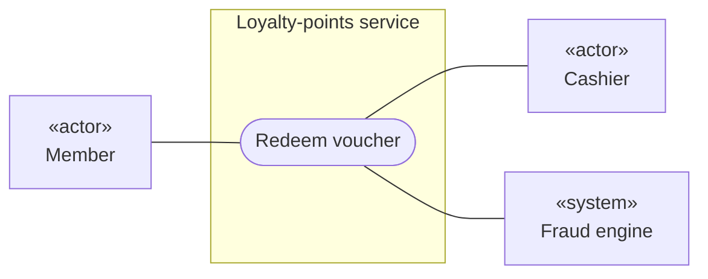
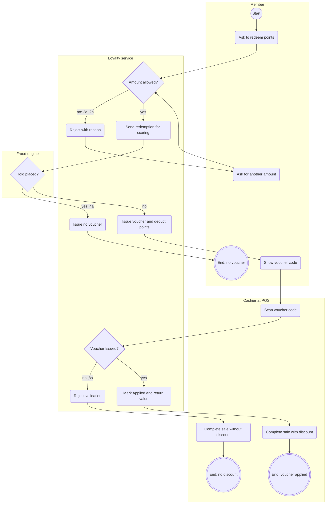

# Use case: Redeem voucher

<!-- Written by the re-skills use-case-spec skill. Keep every heading, table and column, in this order; replace {placeholders}. -->

| Field | Value |
| --- | --- |
| Use case | uc-redeem-voucher |
| Primary actor | Member (via the customer mobile app) |
| Supporting actors | Cashier (via the TillPoint POS); fraud engine |
| Goal in context | The member pays part of a purchase with points: the points become a single-use voucher that the cashier applies at the till. |
| Scope | Loyalty-points service (black box) |
| Level | User goal (one store visit) |
| Trigger | The member asks to redeem points in the customer mobile app. |
| Sources | I-01 (SH-01 Mei Tan, 2026-10-27); S-01 (programme terms draft v3); requirements/context.md; SH-01 2026-11-03 (end point, primary actor); SH-02 on record |
| Status | draft |

## Stakeholders and interests

| Stakeholder | Interest |
| --- | --- |
| Member | Gets the discount at the till; loses no points when something fails. |
| SH-01 Head of Loyalty | The minimum and the voucher value are applied the same way every time. |
| SH-02 Store operations lead | Checkout does not get slower. |
| SH-03 Finance controller | The voucher value always matches the points deducted. |
| SH-05 Security architect | Every redemption is scored by the fraud engine before a voucher exists. |

## Preconditions

- The customer mobile app has identified the member to the loyalty service.

## Minimal guarantee

- The member's points balance changes only when a voucher is issued.
- A voucher is applied to at most one purchase.

## Success guarantee

- The voucher is Applied to the member's purchase and the POS has its value.
- The member's redeemable balance is lower by the redeemed points.

## Main success scenario

| Step | Actor | Action | Requirements |
| --- | --- | --- | --- |
| 1 | Member | Asks to redeem a number of points. | none: actor step |
| 2 | Loyalty service | Checks that the amount is at least the minimum (BR2) and within the member's redeemable balance (BR3). | R-040, new: R-043 |
| 3 | Loyalty service | Sends the redemption to the fraud engine for scoring. | new: R-044 |
| 4 | Fraud engine | Returns a score with no hold. | none: actor step |
| 5 | Loyalty service | Issues a single-use voucher worth SGD 1 per 100 points (BR1), deducts the points and returns the voucher code. | R-041, R-042, new: R-045, R-046 |
| 6 | Member | Shows the voucher code to the cashier at checkout. | none: actor step (printing is open decision D-02, Q7) |
| 7 | Cashier | Scans the voucher code at the POS. | none: actor step |
| 8 | Loyalty service | Validates the voucher for the POS, marks it Applied and returns its value. | new: R-047, R-048 |
| 9 | Cashier | Completes the sale with the discount. | none: actor step |

## Alternatives

Extensions after which the goal is still reached.

| Ref | Condition | Step | Action | Requirements |
| --- | --- | --- | --- | --- |
| 2a | The requested points exceed the member's redeemable balance (for example, some points are still pending) | 2a1 | Loyalty service rejects the request with the member's redeemable balance. | R-043 |
| 2a | | 2a2 | Member asks for a smaller amount; resume at step 2. | none: actor step |
| 2b | The requested points are fewer than the minimum (BR2) | 2b1 | Loyalty service rejects the request. | R-040 |
| 2b | | 2b2 | Member asks for a larger amount; resume at step 2. | none: actor step |

## Exceptions

Extensions after which the goal is abandoned; the minimal guarantee holds.

| Ref | Condition | Step | Action | Requirements |
| --- | --- | --- | --- | --- |
| 2c | The requested points are not a multiple of 100 (BR1) | 2c1 | TBD (Q1: reject, round down or allow); use case ends in failure. | none until Q1 |
| 4a | The fraud engine places a hold on the redemption | 4a1 | Loyalty service issues no voucher and leaves the member's points balance unchanged. | new: R-049 |
| 4a | | 4a2 | Loyalty service tells the member that the redemption cannot be completed now (wording: Q2); use case ends in failure. | none until Q2 |
| 4b | The fraud engine does not answer within TBD seconds (Q3) | 4b1 | TBD (Q3); use case ends in failure. | none until Q3 |
| 8a | The voucher is not in state Issued (already Applied, Expired or Cancelled) or its code is unknown | 8a1 | Loyalty service rejects the validation with the reason. | new: R-050 |
| 8a | | 8a2 | Cashier completes the sale without the discount; use case ends in failure. | none: actor step |
| 8b | The POS cannot reach the loyalty service | 8b1 | TBD (Q5: complete the sale without the discount and keep the voucher Issued); use case ends in failure. | none until Q5 |

## Business rules

| Rule | Statement | Source |
| --- | --- | --- |
| BR1 | 100 points give SGD 1 of voucher value. | S-01 |
| BR2 | The minimum redemption is 500 points. | S-01 |
| BR3 | Only posted points are redeemable; points post 24 hours after purchase. | S-01 |
| BR4 | A voucher can be used once; an unused voucher expires after TBD (Q4). | I-01 |

## Diagrams

### Use case diagram

### Activity diagram

Drawn because: 7 extensions, a loop (2a and 2b resume at step 2), and two sessions (app, then till).

Not drawn until answered: 2c (Q1), 4b (Q3), 8b (Q5).

## Requirements proposed

Rows are also appended to `requirements/requirements.csv`; that file wins if the texts differ.

| R-ID | Text | Step | Status |
| --- | --- | --- | --- |
| R-043 | IF a redemption request asks for more points than the member's redeemable balance, THEN the loyalty service shall reject the request with the member's redeemable balance in the response. | 2, 2a1 | draft |
| R-044 | WHEN a redemption request passes the minimum and balance checks, the loyalty service shall send it to the fraud engine for scoring before issuing a voucher. | 3 | draft |
| R-045 | WHEN the fraud engine returns no hold for a redemption, the loyalty service shall issue a single-use voucher to the member. | 5 | draft |
| R-046 | WHEN the loyalty service issues a voucher, the loyalty service shall deduct the redeemed points from the member's redeemable balance. | 5 | draft |
| R-047 | WHEN the POS requests validation of a voucher in state Issued, the loyalty service shall return the voucher value to the POS. | 8 | draft |
| R-048 | WHEN the loyalty service returns a voucher value to the POS, the loyalty service shall set the voucher to Applied. | 8 | draft |
| R-049 | IF the fraud engine places a hold on a redemption, THEN the loyalty service shall leave the member's points balance unchanged without issuing a voucher. | 4a1 | draft |
| R-050 | IF the POS requests validation of a voucher that is not in state Issued or whose code is unknown, THEN the loyalty service shall reject the validation with the reason. | 8a1 | draft |

## Open issues

| # | Question | Owner | Affects |
| --- | --- | --- | --- |
| Q1 | May a member redeem an amount that is not a multiple of 100 points? If yes, what is the voucher value? | SH-01 Mei Tan | 2c, BR1 |
| Q2 | What may the member be told when the fraud engine holds a redemption? | SH-05 Lena Koh | 4a2 |
| Q3 | How long may the loyalty service wait for the fraud engine, and what happens after that? | SH-05 Lena Koh, SH-02 Arjun Pillai | 4b |
| Q4 | How long is an unused voucher valid? | SH-01 Mei Tan | BR4 |
| Q5 | When the POS cannot reach the loyalty service, does the sale complete without the discount, and does the voucher stay Issued? | SH-02 Arjun Pillai | 8b |
| Q6 | If the cashier voids the sale after validation, does the voucher go back to Issued? Next: run `state-model` for Voucher. | SH-02 Arjun Pillai | step 8, R-048 |
| Q7 | Voucher printing at the POS: POS vendor or us (open decision D-02)? | SH-01 Mei Tan, SH-09 POS vendor | step 6 |
