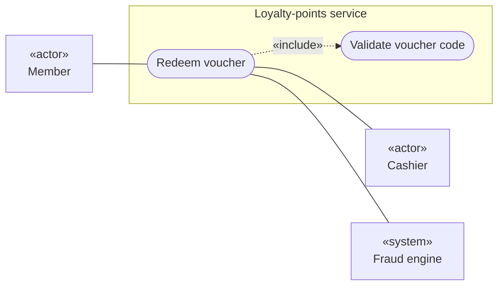
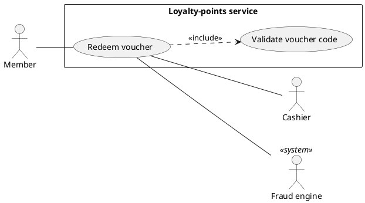
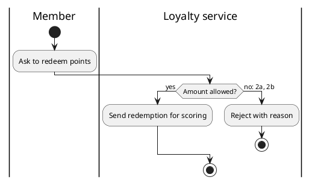

# Diagram conventions for use cases

Mermaid has no use case diagram type. This skill draws one with a fixed flowchart convention, so every `uc-*.md` file reads the same way. It renders in GitHub, GitLab and Obsidian.

## Use case diagram (Mermaid flowchart)

| Element | Mermaid | Rule |
| --- | --- | --- |
| Diagram | `flowchart LR` | Left to right: primary actors, system boundary, supporting actors. |
| System boundary | `subgraph sud["Loyalty-points service"]` ... `end` | The system under design, named as in `context.md`. Only use cases go inside. |
| Use case | `uc1(["Redeem voucher"])` | Stadium shape (the closest Mermaid has to an ellipse). Verb and object. `uc1` is the use case of this file; others are `uc2`, `uc3`. |
| Person actor | `member["«actor» Member"]` | Rectangle with the «actor» stereotype on its own line. |
| System actor | `fraud["«system» Fraud engine"]` | Rectangle with the «system» stereotype. |
| Primary actor association | `member --- uc1` | Plain line, actor first: Mermaid then places the actor left of the boundary. |
| Supporting actor association | `uc1 --- fraud` | Plain line, use case first: the actor is placed to the right. |
| Include | `uc1 -.->\|«include»\| uc2` | Dotted arrow from the base use case to the use case it always includes. |
| Extend | `uc3 -.->\|«extend»\| uc1` | Dotted arrow from the extending use case to the base it extends. |
| Actor generalization | not drawn | Mermaid has no hollow-triangle arrow. Say it in the Supporting actors field ("Approver is a support agent"). |

Rules:

- Draw this file's use case, all its actors, and only those other use cases it includes or that extend it. The system-wide picture belongs in `context.md`.
- Channels (the customer mobile app, the POS) are not actors when they only carry the actor's request; name them in the actor field ("via the customer mobile app"). An external system that decides something (the fraud engine) is a supporting actor.
- No `classDef`, `style` or colors. Quote labels that contain punctuation. Never use `end` as a node ID.

### PlantUML alternative

Only when the user asks or `schema.json` asks for PlantUML.

## Activity diagram of the scenarios

Draw it when any of these holds: more than 3 extensions; an extension resumes at an earlier step; the scenario spans more than one session or channel. Up to three extensions, no loop and one session, the numbered list is easier to read than a diagram.

The shapes are the ones the `process-flow` skill uses, repeated here so this skill works on its own:

| Element | Mermaid | Rule |
| --- | --- | --- |
| Lane | `subgraph svc["Loyalty service"]` ... `end` | One per actor that acts in the scenario. Label about 20 characters at most: Mermaid clips longer lane titles. |
| Start | `start((Start))` | One. |
| End | `ok(((End: voucher applied)))`, `fail(((End: no discount)))` | One per outcome: success, and failure where the minimal guarantee holds. |
| Step | `s3(Send redemption for scoring)` | ID `s` plus the step number; extension sub-steps `x` plus their number (`x2a1`). Short verb-and-object label. |
| Decision | `d2{Amount allowed?}` | The check inside a step whose outcome branches, ID `d` plus the step number. Every outgoing edge labeled with the outcome and the extension refs: `d2 -->\|"no: 2a, 2b"\| x2a1`. |
| Fork, join | `f1{{fork}}`, `j1{{join}}` | Only if the scenario has steps that really run in parallel. |

Draw only resolved paths. Extensions whose response is `TBD` are listed in one line under the diagram ("Not drawn until answered: 2c (Q1), 4b (Q3)"). Keep the diagram within 15 step and decision nodes; if it would be larger, the use case is probably above user-goal level.

### PlantUML alternative

